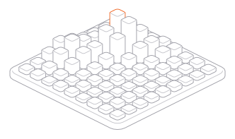
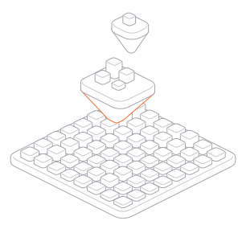
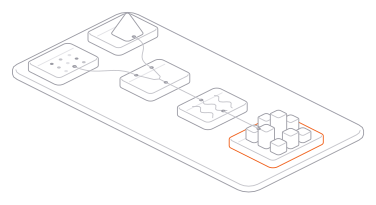
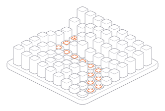
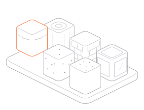
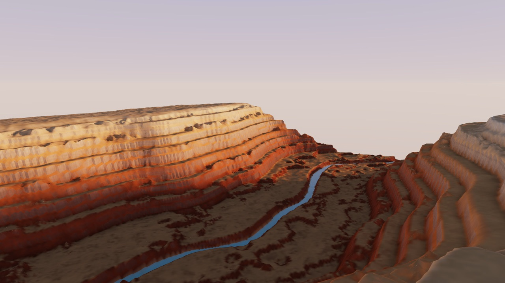
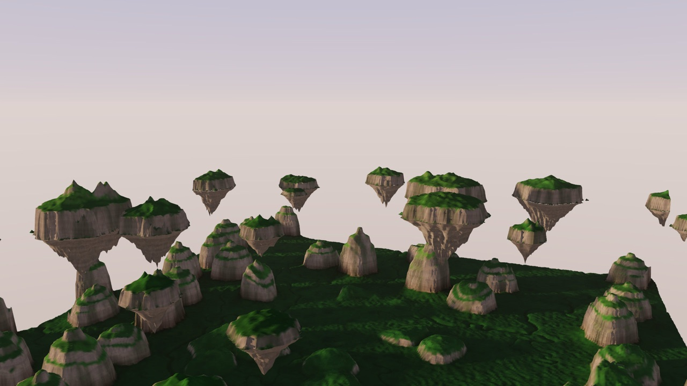
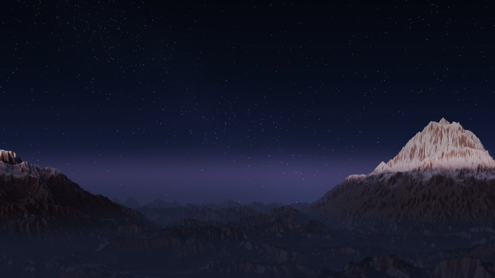

<div align="center">

<picture>
  <source media="(prefers-color-scheme: dark)" srcset="docs/assets/hero-dark.svg">
  
</picture>

**The successor to WorldPainter, made for maps tens of thousands of blocks wide.**

[**Download**](https://github.com/M-U-C-K-A/Massif/releases) · [Guide](docs/guide.md) · [Terrain graphs](docs/terrain-graphs.md) · [How it works](docs/internals.md) · [Roadmap](#roadmap)

</div>

<br>

Shape and paint a map from above with WorldPainter's brushes and controls.
Build what a height map cannot hold: overhangs, arches, floating islands,
caves. Grow terrain from a node graph in the manner of Gaea, see every block of
the map in 3D, and export a world that Minecraft opens, from 1.7.10 to 26.3.

No garbage-collector pauses, a few hundred megabytes for a 16k × 16k map, and
every CPU core at work.

> [!NOTE]
> Massif is in early development. Worlds, tools and the file format work end to
> end and are covered by tests; some of WorldPainter's features, layers in
> particular, are still on the way.

## Highlights

<table>
<tr>
<td width="50%">
<picture>
  <source media="(prefers-color-scheme: dark)" srcset="docs/assets/brush-dark.svg">
  
</picture>
</td>
<td width="50%">

### Paint from above

WorldPainter's way of working, kept: its twelve brushes and their profiles,
22 terrain stamps (peaks, ranges, volcanoes, mesas…), your own greyscale
images, a radius up to 4,096 blocks, and its mouse and keyboard. Your
WorldPainter brushes folder is read as it is.

Options limit where a brush acts: a band of heights, only on or except on a
terrain or a biome, steep or gentle slopes, the side a slope faces, hollows
or bumps.

</td>
</tr>
</table>

<table>
<tr>
<td width="50%">

### Rock over the void

A map is a stack of levels: the ground, solid levels that add rock
(overhangs, arches, floating islands) and carve levels that take it away
(caves, tunnels, pits), all painted with the same brushes.

Where that is not enough, **3D Sculpt** pushes, smooths and paints the
matter itself, in sparse 16³ voxel chunks, and walks the land as a player
would.

</td>
<td width="50%">
<picture>
  <source media="(prefers-color-scheme: dark)" srcset="docs/assets/islands-dark.svg">
  
</picture>
</td>
</tr>
</table>

<table>
<tr>
<td width="50%">
<picture>
  <source media="(prefers-color-scheme: dark)" srcset="docs/assets/graph-dark.svg">
  
</picture>
</td>
<td width="50%">

### A terrain graph

The Terrain side is a node-based generator in the manner of Gaea: about sixty
nodes (tectonic plates, mountains, volcanoes, canyons, dunes, erosion, snow,
rivers, climate, biomes, colour), landscapes to start from, and a viewport
with a sun, clouds, haze and a sea.

Graphs build at up to 16,384 × 16,384 and turn into voxels: colours become
the closest real blocks, floating rock becomes levels of the map. A graph can
start from the map you painted.

</td>
</tr>
</table>

<table>
<tr>
<td width="50%">

### Rivers that follow the land

Click a source and the water finds its own way down, filling the hollows it
meets, to the sea. Click where it should end, drag its course to bend it,
and it is dug with banks that ease into the land, from a brook to hundreds
of blocks wide.

Or let a graph trace whole river systems in the valleys of a map, lakes in
its hollows, keeping the water already painted in WorldPainter.

</td>
<td width="50%">
<picture>
  <source media="(prefers-color-scheme: dark)" srcset="docs/assets/rivers-dark.svg">
  
</picture>
</td>
</tr>
</table>

<table>
<tr>
<td width="50%">
<picture>
  <source media="(prefers-color-scheme: dark)" srcset="docs/assets/blocks-dark.svg">
  
</picture>
</td>
<td width="50%">

### The game's own blocks

Every block of the Minecraft version you have installed (1,288 in 26.3) is
read from the game itself, with its textures and colours. Terrains show the
real blocks, any whole block can be painted, and plants become ground covers
that grow over the land.

Trees, rocks and ruins come in from WorldEdit, MCEdit, Axiom, Litematica and
structure files, painted as layers.

</td>
</tr>
</table>

### And also

- **WorldPainter import.** `.world` files are read directly, without Java: a
  100 MB world in about a second.
- **Blocks from mods.** Any mod's blocks (Conquest Reforged's 17,000, Chipped,
  Macaw's…), in its own creative tabs, read from its instance in one click
  and exported for the version it plays, every block state the game's.
- **Export for the version you play.** From 1.7.10 to 26.3 and whatever is
  installed, each version in the chunk format it reads, worlds up to 2,032
  blocks high.
- **The whole map in 3D.** A GPU ray tracer draws every block of the map, at
  any distance.
- **Huge maps.** 60,000 × 50,000 blocks, generated in a minute and edited at
  once.
- **Automatic biomes and paint.** Biomes read from the shape of the land,
  ground painted from its biome, by rules you can change.
- **A file format that keeps.** `.massif` stores every 128 × 128 tile as an
  independent, checksummed zstd frame; the Finder and Explorer show the map as
  the file's icon.

## Made with Massif

<table>
<tr>
<td></td>
<td></td>
<td></td>
</tr>
</table>

Made and rendered in Massif.

## Getting started

### Download

Builds for Windows, macOS (Apple silicon and Intel) and Linux are on the
[releases page](https://github.com/M-U-C-K-A/Massif/releases). They are not
signed: on macOS, right-click Massif.app and choose **Open** the first time
(or run `xattr -dr com.apple.quarantine Massif.app`); on Windows, choose
**More info ▸ Run anyway** if SmartScreen asks.

Massif opens on its home screen: make a new map, open one, or import a
WorldPainter world. **F1** opens the help.

### Build from source

Massif needs a Rust toolchain; the exact version is pinned in
`rust-toolchain.toml` and `rustup` installs it.

```bash
cargo run --release -p massif-app
```

Open a map directly (a WorldPainter `.world` is imported the same way):

```bash
cargo run --release -p massif-app -- path/to/world.massif
```

On a Mac, `tools/install-macos.sh` builds Massif and installs **Massif.app**
in Applications; run it again after pulling changes.

### Command line

`massif-cli` creates, inspects, verifies, imports and exports worlds without
opening the editor:

```bash
cargo run --release -p massif-cli -- new world.massif --size 125x125 --landform mountains
cargo run --release -p massif-cli -- info world.massif
cargo run --release -p massif-cli -- verify world.massif
cargo run --release -p massif-cli -- import old.world world.massif
cargo run --release -p massif-cli -- export world.massif ~/Library/Application\ Support/minecraft/saves/MyWorld --version 1.21.11
```

## Documentation

- **[Using Massif](docs/guide.md)**: the home screen, the window and its
  areas, brushes and their options, painting, ground covers and objects,
  rivers, height maps, 3D Sculpt, the controls.
- **[Terrain graphs](docs/terrain-graphs.md)**: the generator, its viewport
  and render, templates, nodes, rivers, climate, plates, and the conversion to
  voxels.
- **[How it works](docs/internals.md)**: the world model, sculpted volumes,
  the `.massif` format, WorldPainter import, Minecraft export, the 3D view,
  very large maps.
- **[Development](docs/development.md)**: building, the tests, and checking
  an export in the game itself.

## Project layout

Massif is a Cargo workspace of nine crates:

- [`massif-core`](crates/massif-core): the world model (coordinates, RLE
  planes, tiles, levels, column composition, voxel chunks), brushes, stamps
  and filters, editing operations, undo, terrain generation and terrain
  graphs. No graphics dependency.
- [`massif-format`](crates/massif-format): reading and writing `.massif`
  files.
- [`massif-anvil`](crates/massif-anvil): Minecraft Java export: NBT, region
  files, `level.dat`.
- [`massif-legacy`](crates/massif-legacy): WorldPainter `.world` import, with
  a Java serialization reader written in Rust.
- [`massif-objects`](crates/massif-objects): custom objects, read from
  Sponge, MCEdit, Axiom, Litematica and structure files.
- [`massif-assets`](crates/massif-assets): the game's real blocks: finds the
  installed client jars, reads their block states, models and textures.
- [`massif-thumbnails`](crates/massif-thumbnails): the map as a `.massif`
  file's thumbnail in Windows Explorer (a COM thumbnail handler).
- [`massif-app`](crates/massif-app): the editor (egui and wgpu): areas, map,
  3D view, panels.
- [`massif-cli`](crates/massif-cli): the command-line tool.

## Roadmap

- WorldPainter layers (trees, ores, frost, roads…) and their import from
  `.world` files; layers as brush filters and graph outputs; block entities
  of custom objects.
- Terrain graphs: GPU evaluation, groups and portals, graphs applied to a
  part of the map, tiled builds beyond 16,384 samples, more simulations
  (glaciers, sediment layers), the render drawn from the full-resolution
  build, carved layers (caves and arches) and water on floating rock (lakes,
  falls), river courses drawn in the graph, the direction of rivers' flow for
  fluid mods.
- The real blocks' textures in the 3D view, and custom terrains mixing real
  blocks in layers.
- Trees and plants as a sign of forests for the automatic biomes; covers from
  the graph and the automatic paint.
- Selections, copy and paste.
- Nether and End editing from the editor, customisable key bindings.

## Supporters

A special thank you to **Chonky cow cat**, whose donation helps keep Massif
growing. Your support means a lot. Thank you for believing in the project!

## License

Massif is licensed under the GPL-3.0-or-later (declared in `Cargo.toml`), like
WorldPainter.
