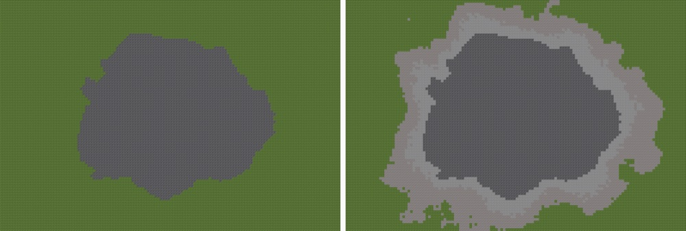

# Using Massif

[← Back to the README](../README.md)

The editor, part by part: the home screen, the window, brushes and their options, painting, decorating, water, height maps, 3D sculpting and the controls. The terrain generator has [a page of its own](terrain-graphs.md); how Massif works inside is in [internals](internals.md). Coming from WorldPainter? [Where each of its tools is](coming-from-worldpainter.md).

- [The home screen](#the-home-screen)
- [The window](#the-window)
- [Settings](#settings)
- [New worlds and export](#new-worlds-and-export)
- [Brushes](#brushes)
- [Automatic biomes and paint](#automatic-biomes-and-paint)
- [Noise painting](#noise-painting)
- [Reference images](#reference-images)
- [Layers](#layers)
- [Packs](#packs)
- [Ground covers](#ground-covers)
- [Custom objects](#custom-objects)
- [Rivers](#rivers)
- [Roads](#roads)
- [Height maps](#height-maps)
- [Real blocks](#real-blocks)
- [3D Sculpt](#3d-sculpt)
- [Cards](#cards)
- [In the Finder and Explorer](#in-the-finder-and-explorer)
- [Controls](#controls)

## The home screen

Massif opens on its home screen. On the left are the ways in — **New map**,
**From a height map**, **Open a map…** (a `.massif`), **Import from
WorldPainter…** (a `.world`) — and the maps opened lately. In the middle are
the settings of a new map beside a preview of the whole map, as tall as they
are (the cross marks its centre), and **Create map**. What is written over the
picture has a halo of the page's colour around its letters, so that it reads
over any part of it. A `.massif`, a `.world` or a height map dropped on the
window opens too.
**File ▸ New** (⌘N) comes back to the home screen, with a way back to the open
map (Esc).

Under the ways in, **Samples** offers three small maps to explore at once:
**Alpine range**, **Archipelago** and **Floating mountains**, 768 blocks a
side. None is shipped with Massif: a click makes the map from that template of
the terrain generator, builds its relief on the Terrain side (a few seconds),
then shows it on the World side, with nothing to save until you change it.

### The tour

The first time a map is open in Massif, a short tour shows the window, in six
steps: the World and Terrain sides, the tools, Brush Settings, the 2D map, the
3D view, and saving and exporting. Each step dims the window but for the part
it talks about and says a few words beside it. **Next** and **Back** (or the
arrow keys) move through it; **Skip tour** or Esc ends it at any step. With
**Don't show again** ticked, as it is at first, it does not come back on its
own; **Help ▸ Take the tour** shows it again (over a sample, from the home
screen). Massif shows no other tips or popups. With Reduce motion on, the
light jumps from one part to the next rather than gliding.

Before it, the very first start asks **Coming from WorldPainter?** **Yes**
opens the WorldPainter workspace (the map big in the middle, the tools on the
left, Terrain, Layers and Brushes on the right), sets WorldPainter's keyboard
shortcuts, and shows a tour of its own instead, eight steps from where
WorldPainter put each thing to where Massif has it, then what Massif adds.
**No** keeps Massif's layout and the tour above. **Help ▸ Where are my
WorldPainter tools?** shows that tour again. [Coming from
WorldPainter](coming-from-worldpainter.md) has the whole table.

Behind it is the background chosen in **Settings ▸ Appearance ▸ Home
background**, one of four styles:

- **Ridges**, the default: six ranges of mountains seen from afar, one in
  front of the other, under a glow of the accent low on the right, as of a
  sun gone down. Each range is a band: a jagged crest, grey with sparks of the
  accent away from the glow, thicker and white-hot toward it, over land that
  darkens down from the crest, the far ranges paler in the haze, the near ones
  almost black, all of them warmed where the glow reaches. The sky is the
  page's own colour but for the glow. Every cell is dithered, its colour put
  to one of a few levels by an ordered threshold, so that the light is made of
  dots. The ranges drift, the nearer faster, and breathe; the glow pulses.
  **Palette** colours the glow and the crests (**Theme**, the accent, by
  default; **Ember**, **Glacier**, **Dusk**, **Forest**), **Height** sets how
  tall the ranges rise (60 to 140 %), **Glow** how strong the glow is (0 to
  150 %) and **Ranges** how many there are, one behind the other (3 to 8).
- **Waves**: smooth bands of colour rising from the foot and melting into
  each other, a deep colour above them, their seams curving and rolling
  slowly. **Palette** picks their six colours (**Theme**, from the accent;
  **Flamingo**, the default; **Lagoon**, **Ember**, **Glacier**, **Ink**),
  **Scale** how broad the swells are, **Melt** how soft their seams,
  **Speed** how fast they roll, and **Direction** the side they rise from.
- **Pixel**: the same waves in large square pixels; **Pixel size** sets how
  many there are across.
- **Prism**: columns of colour side by side, crisp, each a gradient, their
  tips drawing a **Shape** (**Crest**, **Valley**, **Tide**, **Slant**,
  **Lens**) that grows from the side **Direction** says and moves as
  **Motion** says (**Expand**: swells running out from the middle;
  **Gather**: running in; **Breathe**: all of it rising and falling), in its
  own palettes (**Theme**, **Ember**, the default, **Ultraviolet**,
  **Petrol**, **Citron**, **Blue hour**).

The page shows the background alive above its settings; it looks right
without touching any of them. In the light theme the waves keep their order —
deep at the top, light at the foot — softened into pastels with softer seams
and lower swells; in high contrast the colours turn to calm greys (the ridges
keep only their crests). Over Waves, Pixel and Prism, the settings of a new
map sit on a solid surface of the card's colour. Whatever the choice, the colours are held toward the page's own
under the settings and around them, a soft haze that fades out, so that
muted text keeps at least 3 to 1 on them. The ridges are drawn on the
processor; the other styles are meshes of a few thousand corners whose
colours the graphics card blends, well under a millisecond of work a frame.
Any of them moves at 12 frames a second at most, only while the home screen
is shown and the window is in front; with **Animate the background** off or
Reduce motion on, it stands still.

## The window

The window is made of areas, as in Blender. Each area shows any editor: the
map, the 3D view, tools, tool settings, brush settings, brushes, custom
brushes, terrain and biome palettes, levels or world info.

- The icon before an area's title opens every editor on one page, in
  columns: the World side's views, tools and paint, then the Terrain
  side's generator and the Render side's panels. The line under them says what the one under the
  pointer is for, and whether another area shows it already. An empty
  area holds the same page.
- The ⋮ menu of an area splits it, joins it with its neighbour, maximises it
  (Ctrl+Space) or closes it. Hold Shift for a one-click close button.
- **Float** in that menu takes the area out of the layout into a window of
  its own over it: drag its title to move it, its bottom right corner to
  size it. **Dock back** in its own ⋮ menu puts it back beside the largest
  area; or drag its title with **Shift** held onto an area, to dock it on
  that side of it (onto the centre: in its place, that one floating
  instead). Any editor floats, on any side; floating panels are saved with
  their workspace and come back where they were.
- Drag any corner of an area into it to split it where you let go: the new area opens on that corner's side (across: left or right; up or down: above or below).
- Drag an area by its title onto another to move it, or onto its centre to
  swap the two. Drag the gaps between areas to resize them.
- The app has three sides, switched at the top left: **Terrain**, the
  terrain generator (Graph and Render), **World**, the map editor
  (workspaces Layout, Sculpting, Painting, 3D, 3D Sculpt, Maps, Minimal),
  and **Render**, marked Beta, where the map is path-traced and saved as
  images (workspaces Still and Animation, see [Render](#render)). Each
  side remembers the workspace it was left on.
- Workspaces are tabs of arrangements; duplicate one with `+`, right-click
  it to reset it (back to how it was at first; a copy goes back to what it
  was copied from), duplicate it or delete it. The layout is remembered.
- Each 3D View area is a view of its own: its mode (Terrain, Height,
  Slope, Biome, Relief), its water and its camera. Split one to watch the
  map in Terrain and in Slope side by side; each area is remembered with
  the layout (a duplicated workspace keeps them), and a new one opens in
  Terrain, looking where the first 3D View looks. Two areas in one mode
  each build their own tiles; a view out of sight builds nothing and gives
  its memory back after a while.

A slider is a slim track with its value after it: click the track to jump
there, drag the thumb (Shift: finer), drag the value sideways, or click it to
type one. A number clicked to be typed in gets the caret where it was clicked
(in any number field), so that a digit adds to it rather than replacing it. A
narrow Tools area keeps each row of tools on one line, its name under the
pointer; the tools have icons drawn for what they do to the land.

What Massif did and what runs in the background (saving, exporting, the
automatic tools over a whole map) shows at the bottom right of the window,
over the areas, with a **Cancel** for long tasks.

The 2D map's header picks what it shows (Terrain, Height, Slope, Biome,
Relief) and what goes over it: contour lines, **Block steps** and the tile and
chunk grid. With **Block steps** on, the default, the map close up (a pixel
or more for each block) is shaded from the height of each column's top block,
as the game's own maps are: each block is compared with its neighbour on the
side the light comes from, so a step of one block is a sharp line one block
wide, lit where it faces the light and in shadow at its foot, and the contour
lines follow the blocks. Off, the shading follows the smooth height the ground
was shaped to, softer and without the steps. A little further out, where a
pixel spans 2 × 2 or 4 × 4 blocks, the light of the hillsides is the smooth
one and each step still draws its line over it, thinner and fainter the
further out; further still, where a pixel spans 8 blocks or more, both are
the smooth shading.

**Help ▸ Massif Help** (F1) opens the help: every part of Massif, topic by
topic, with a search, and the keyboard shortcuts.

### Menus

**Massif**, **File**, **Edit**, **View** and **Help** hold every command,
each item with its shortcut beside it. An item is greyed out when it cannot be used: what
acts on the map waits while the home screen is shown, and everything but
Quit waits while a dialog is open or a map is being opened.

On a Mac they are in the menu bar at the top of the screen, as in every Mac
app, and the window's top bar keeps only its buttons. **About Massif**,
**Settings…** (⌘,) and **Quit Massif** (⌘Q) are in the **Massif** menu,
where Mac apps keep them, and **Help** has the system's search of the menus.
**Help ▸ Join the Discord…** opens [Massif's Discord](https://discord.gg/2dP7xJb655) in your
browser: questions, maps to show, and `#bug-reports`.
⌘Q asks first when the map has changes that are not saved. On Windows and
Linux the menus sit at the top left of the window, with Ctrl for ⌘, and the
first, **Massif**, stands for the Mac's: **About Massif**, **Settings…**
(Ctrl+,), **Check for Updates…** (asks GitHub at once, whatever the daily
check, and opens Settings ▸ Updates with the answer), then **Full Screen**
(F11) and **Quit** (Ctrl+Q), which asks first as ⌘Q does.

On a Mac, quitting from the Dock (**Quit** in Massif's menu there) or from
the app switcher (⌘Tab, then Q) asks as ⌘Q does, Massif coming to the front
for it. So does a logout, a restart or a shut-down, which waits for the
answer: **Save** or **Don't Save**, and it goes on once Massif has quit;
**Cancel**, and it stops, Massif and its map as they were. The Mac waits two
minutes at most before it gives up the logout. With no changes to save,
Massif quits at once.

The menu bar shows the shortcuts of File, Edit, View and Help without taking
their keys: these still go to the window, so ⌘Z undoes in the map, in a text
field or in Edit ▸ Ores as before, and ⌘C, ⌘V and ⌘A work in text fields.

## Settings

**Settings** (⌘, — in the **Massif** menu, the first, on every system — or
the home screen's sidebar) has ten sections, in a window of
their own:

- **Appearance**: the theme (**Follow the system**, the default, **Light**
  or **Dark**; also in the **View** menu), the accent colour (the colour of what is
  chosen, of the main buttons and of the home screen's art: eight colours, or
  any other), the **Loader** shown while Massif works (eight grids of dots
  lighting in patterns — Orbit, Ripple, Scan, Rain, Bars, Spiral, Sweep,
  Twinkle — each alive in its tile, still with Reduce motion), the **Tool
  icons** (**Line**, the default, in the style of the interface's other
  icons, or **Classic**, Massif's first drawings), the **Crosshair** of the player's view: a **Dot**, a
  **Cross** (the default: four short strokes around an open middle), a
  **Circle**, a plain **Minecraft** plus, or **None**, with its **Size** (6
  to 32 points) and **Opacity**, beside a preview on light ground and dark.
  It is drawn white in a soft dark outline, so that it shows on snow as on
  deep water, more strongly in high contrast. The 2D map draws it under the
  pointer too, in place of the system's thin black crosshair; with **None**,
  the map keeps the system's crosshair. Last, the **Home background** (**Ridges**, **Waves**, **Pixel**
  or **Prism**, alive in a picture above its few settings, and **Animate the
  background**; see [the home screen](#the-home-screen)).
- **Accessibility**: **High contrast** — text black or white, muted text
  past 7 to 1 on the cards, lines and the edges of controls past 3 to 1, the
  accent darkened or lightened until it reads, links underlined, and the
  home screen's ridges reduced to their crests, none behind its words; **Reduce motion** — the map
  and the 3D views stop where they are let go and go straight where they are
  sent (no gliding on, no coasting, no easing), the home screen's ridges and
  the cards of tools and brushes stay still, switches flip at once; and
  **Interface size** — 100, 110, 125 or 150 %, everything larger at once (⌘+
  and ⌘− change it too, ⌘0 puts it back, and the change is kept). On macOS
  the first two follow the system by default (System Settings ▸
  Accessibility ▸ Display: Increase contrast, Reduce motion), and can be set
  off or on whatever it says.
- **Typeface**: what the interface is set in — the system's own (SF Pro on
  macOS, Segoe UI on Windows), or one of four built into Massif: **Inter**,
  drawn for screens, **Geist**, a crisp geometric grotesque, **IBM Plex
  Sans**, engineered, and **Manrope**, open and rounded. All are variable
  fonts under the SIL Open Font License, so the medium and semi-bold of
  titles and values are real weights. Each is shown in itself, and a click
  sets the whole interface in it, at once.
- **Sounds**: little sounds, synthesised as they play — soft mallets,
  clicks and air, as [Cuelume](https://cuelume.dev/) makes them, so there
  is no sound file in the app: three notes rising when a long task is done,
  two when the map is saved, a low pair when something fails, one wavering
  when something is refused or stopped; with **All**, soft ticks for
  choices, switches, windows opening and closing, workspaces. **Off**,
  **Essential** (what ends and what fails) or **All**, a volume, and each
  sound to hear. The sound output is open only while a sound plays (and two
  seconds after): silent, Massif holds neither the speakers nor wireless
  headphones, which can go to another device.
- **Notifications**: the system's own (the Notification Centre, a toast on
  Windows, the desktop's on Linux) when a task of more than two seconds ends
  — an export, an import, a conversion, a pass over the whole map —:
  never, while Massif is not in front, or always; and a button to try it.
- **Memory**: a limit (automatic, 1, 2, 4 or 8 GB) for what is kept decoded
  — three fifths for the map's tiles, measured at the size they take, the
  rest for the column data and images of the map view —, beyond which what
  was used least is put away, compressed; and what is in use now.
- **Autosave**: on or off, and how often: every 1, 2, 5 (the default), 10
  or 15 minutes of changes not saved (see [Autosave](#autosave)).
- **Updates**: **Check for new versions**, on by default (see
  [New versions](#new-versions)), and the version skipped, to be told of
  again.
- **Graphics**: how much the graphics card is asked to do. **Low**,
  **Medium** and **High** set everything at once; a change to any setting
  makes it **Custom**, and every change applies at once, without a restart.
  The 3D views: their **Render scale** (drawn at 50, 67, 85 or 100 % of
  their pixels and stretched to fit: what saves the most, close to half the
  time at 67 %), **Smooth edges** (four samples a pixel; once the view has
  been still for a moment, the traced ground is drawn again with a ray
  through each sample, its steps' edges smoothed too, for about three times
  the time of that one frame), **Fog**, **Water
  reflections**, **Game textures in the 3D views** (each block drawn with
  its texture from the game or its mod, in the 3D View and 3D Sculpt as in
  the player's view; off, a flat colour a block, as Low draws them; when no
  Minecraft is found, or the graphics card cannot draw them, the views draw
  the flat colours and a line under the switch says why, also written in
  `startup.log`), and
  how much of the map the 3D view keeps on the graphics card (about 320 MB, 800 MB or
  2 GB): a larger map is drawn with a column every 2, 4 or 8 blocks, all of
  it, coarser — on a huge map with much water, far faster than every block.
  Come low over the land (within 1,500 blocks of it), and the 3D views draw
  every block, textured, over about 3 km around the eyes, made away from
  the frames in a second or so and made again as the eyes move on, the
  land farther off as before; the status line says so (every block near
  the eyes). Water there is drawn as on a smaller map, clearer over the
  shallows, where farther off it is a plain surface.
  The Terrain viewport: its **Light and shadows** (the steps of its
  shadows, clouds and sky light; saved images always take the most) and its
  **Clouds**, what costs the most there. Then the map view's images kept on
  the graphics card (128 MB, 512 MB or 2 GB) and how many frames a second
  the window draws while nothing is touched but something moves (20, 30, 60
  or no limit). On its very first start, Massif picks the preset for the
  graphics card it finds (Low on OpenGL, older integrated graphics or a
  software renderer; Medium on recent integrated graphics; High on a
  graphics card of its own) after drawing a few frames of the 3D view as a
  trial, and writes the choice in `startup.log`; a preset you choose is
  never changed. When the 3D views stay slow for a while as you move them
  (not while their tiles are still being built), a quiet note suggests the
  preset one step lower, with a button that applies it; its × stops the
  suggestion for good.
- **Developer**: developer mode adds a **Developer** panel to every area's
  menu, as the brushes or the layers: frames a second and the time each
  takes (and how much of it is Massif's own work), the memory the system
  counts for Massif and the processor's time, in charts that run live; then
  what is kept decoded, the map, the tasks running, the graphics card, and
  why Massif draws again.
  **Frames a second** sets how the window draws: **Vsync** (the default)
  keeps in step with the screen; 60, 120, 144 or 240 frames a second at
  most, or **Unlimited**, show each frame as soon as it is drawn (the
  graphics card's Immediate mode, else Mailbox; where it has neither, the
  screen still sets the pace). **Draw every frame** keeps the window
  drawing when nothing changes, so the charts show how many frames the
  computer makes. Both apply at once, and only in developer mode.

## New versions

Once a day at most, a moment after it starts and without holding it up,
Massif asks GitHub which release of Massif is the latest. The request
carries Massif's version and nothing else: nothing about you, your computer
or your maps. The answer is kept a day in `update.json`, next to
`startup.log`; offline, or if GitHub does not answer, Massif says nothing.

When the latest release is newer than the version running, a small pill,
**0.6.1 is out**, shows at the right of the top bar, and a line, **Massif
0.6.1 is out**, above **Settings** on the home screen. Either opens the
release's notes: what is new in every version since yours. **Open the
release page** opens it in your browser, to download the new version and
install it as you did this one; Massif never downloads or installs anything
itself. **Skip this version** stops telling of that one (a newer one is
told of again), and **Later** keeps the pill. **Settings ▸ Updates** turns
the check off, or tells of a skipped version again.

## Autosave

While the map has changes not saved, Massif keeps a copy of it: once it has
had changes for the time set in **Settings ▸ Autosave** (5 minutes by
default), then again after each as long. The copy goes to a folder of
Massif's own, never over your file: `Autosave`, next to `startup.log`
(`~/Library/Logs/Massif/Autosave` on a Mac, `%LOCALAPPDATA%\Massif\Autosave`
on Windows, `~/.local/state/massif/Autosave` on Linux). It is taken between
two strokes and written in the background, on threads that give way to the
rest of Massif: on a map of 44,544 × 33,536 blocks (91,176 tiles, a 1 GB
file), the editor stops for 3 to 8 milliseconds to take it, and the frames
keep their pace while it is written (5 to 12 seconds).

Should Massif close without saving — a crash, a forced quit, a power cut —
it shows, the next time it starts, **Restore unsaved changes?**: each map
left so, by name, when its copy was taken, its file and its size.
**Restore** opens the copy as that map, with changes to save (⌘S saves it to
its own file; a map never saved asks where); **Discard** deletes the copy;
**Later** keeps it to be offered at the next start.

Should Massif run into an error while you work, it keeps the map there
and then: it writes a copy at once, whatever the time set, and says
**Massif ran into an error**, with the error. **Save As…** saves the map
under a name of your own; **Carry On** goes back to work; **Quit** closes
Massif and keeps the copy, offered back at the next start as after a crash.
An error in a task in the background (opening, saving, exporting, carving
caves…) only stops that task, the map as it was.

Saving never harms the file already there: Massif writes to a new file
beside it and puts it in place only once it is whole and on the disk. A
full disk, a folder that cannot be written, or a file held by OneDrive, an
antivirus or a backup tool leaves the old file as it was, and the message
says which it was and what to do. Exports, packs, height maps, images and
Massif's own settings are written the same way.

Saving the map removes its copy, and so does closing it: quitting, or
opening or making another map, whether its changes were saved or let go.
At most 5 copies are kept, of at most 4 GB together, the oldest removed
first; a copy that Massif running in another window is keeping is never
removed.

## Save points

A save point keeps the map as it is now under a name — "before the rivers",
"version 2" — to come back to it, open it or compare the map with it later.
**File ▸ Save Point…**, or **Save point…** at the top of the **Versions**
panel (under World in an area's list of editors), asks for its name.

The Versions panel lists the map's points, the newest first, each with a
small picture of it from above, its name and when it was made:

- **Restore** puts the map back as it was then: its land, levels, sculpted
  chunks, selection, blocks and settings (it keeps its name and its points).
  It is one step to undo: ⌘Z brings back the map as it was before.
- **Compare** draws over the 2D map where the map and the point differ: in
  the accent colour where the land is higher or lower, the stronger the more
  blocks; in grey where only its paint differs (terrain, biome, ground
  cover, objects or water). Under the point, the panel counts the columns
  higher, lower and painted differently, and the most the land rose and
  sank. The comparison follows the map as you change it. **Stop comparing**
  takes it off.
- In a point's **…** menu, **Open as a copy** opens the point as a map of its own,
  never saved, to change and save under another name; **Open read-only**
  opens it to look at: any change is taken back at once, and **Save As…**
  makes it a map of its own. Either closes the map open now, asking first
  if it has changes to save. **Rename…** and **Delete…** do what they say.

Save points are kept in the map's `.massif` file, so they go with it when
the file is copied, sent or backed up, and autosave keeps them too. They
take little room: a point shares every tile it has in common with the map
and with the other points, so it costs only the tiles changed since it was
made (128 × 128 blocks each, compressed): on a map of 8,192 blocks a side
(a 50 MB file), thirty points with a change of a few hundred blocks between
each added 4 MB, and saving took as long as without them. Making a point, renaming or
deleting one is a change to save; deleting one takes its tiles out of the
file at the next save. Versions of Massif before 0.6 open a file with save
points as the map alone, and saving it from them drops the points. Save
points are not exported.

## New worlds and export

A new map (the home screen) takes a name, a size (width × depth, in
multiples of 128 blocks, up to 65,536: type any number, and once you press
Enter or leave the field it becomes the nearest multiple, a note under it
saying so — 5000 becomes 4,992), its **height** — Minecraft's own (−64 to 320) or
taller, up to 512, 1024 or 2032 (the highest Minecraft allows), and as deep
as −2032 — its land — a
topography (flat, plains, hills, mountains, islands) with its relief height
(up to fifteen times the landform's in a tall world; peaks close in on the
top of the world rather than being cut flat), feature size and ground
level, or a template of the terrain generator (alpine range, continents,
archipelago…), whose map then opens on the Terrain side with its nodes —
the water level, lava instead of water (opaque and glowing, its shores
scorched basalt and blackstone, never sand), beaches (sand along the
water, up to six blocks from it: low ground farther inland stays grass), automatic terrains
(grass, sand, rock and snow by height and slope) or a single one, and a
seed; a preview of the whole map updates as you change them. A map made
from a height map takes a height too.

**File ▸ Export** writes the world to a Minecraft saves folder for the
version of the game you choose — the newest one installed on the computer
to begin with — with its game mode, difficulty, cheats, hardcore,
structures beyond the map, world border, spawn point, what surrounds the
map (vanilla terrain or void) and data packs (copied in and enabled).
Versions before 1.18 hold 256 blocks of height: the map is cut below 0 and
above 255, and the dialog says so. The water is written so that the game
leaves it as it is (see [Water in the game](#water-in-the-game)). **Test Export** writes only the 3 × 3
tiles around the centre of the map view to a separate folder, to check the
result in the game quickly.

The versions offered go from 1.7.10 to 26.3, and every newer game
installed on the computer. From 1.18.2 on (1.19, 1.20, 1.21 up to 1.21.11,
26.1, 26.2, 26.3), the chunks are written as that version writes them
itself, with its own data version: the game opens them as they are,
without converting them first, so the first load is quicker and nothing is
lost in a conversion. A block or a biome the version does not have yet
becomes the closest one it has — a cherry or pale oak log a birch or dark
oak log, a cherry grove a meadow, a pale garden a dark forest; a block
with nothing alike is left out of trees and plants, and is stone in the
ground — and a block renamed since takes the version's name (short grass
is grass before 1.20.3, an iron chain a chain before 1.21.9). Blocks of
mods are written as they are.

The world's settings are that version's own too: `level.dat` takes the
shape the version gives it (the spawn point and the border as 1.21.9
writes them, the border in a file of its own from 1.21.11), and for 26.1
and later the world is laid out as 26.1 lays it — the regions under
`dimensions/minecraft/overworld/`, the world's generation, weather, time
of day and border in files of their own. The game opens the world as it
is, with no "make a backup" question and nothing converted.

## Survival check

**Edit ▸ Analyse the map…** checks the whole map for a survival game. Every
block is counted as the export writes it — the layers of each column's
terrain, the stone and deepslate under them, the bedrock floor, the water,
the plants of the covers, the blocks of the objects — and the land
measured: the height players stand at, the step from each column to its
neighbours, the water over it, its biome, the land around the spawn point.
On a WorldPainter map of 5,888 blocks a side (4.3 billion blocks) it takes
a few seconds, in the background. The ores are counted where the export
lays them, block for block.

What it finds comes in three tones, as a survival player would read it:

- **Red, breaks survival**: riches lying around (storage blocks of
  diamonds, emeralds or netherite, ores at the surface, or an ore far more
  common than Minecraft makes it underground), bedrock above the bottom
  five layers or at the surface, blocks no player can break (barriers,
  command blocks), holes into the void, no wood at all, no stone for tools,
  a spawn point in lava or over the void.
- **Amber, missing**: ores — the export writes the map's chunks finished,
  so Minecraft adds no ore, tree, village or stronghold to them; the ores
  are the ones the export lays (see [Ores](#ores)), and the card leads
  there —, lava for a Nether portal, water, grass (animals only spawn on
  it), trees near the spawn, leaves to grow wood back, a spawn point in
  water or off the map, peaks cut flat by the top of the world, many drops
  of 23 blocks or more (a fall that kills at full health).
- **What holds up**: the trees, the ores to mine, the water, the grass, the
  floor, the spawn point and its surroundings.

Above them, the way through a game: wood, stone, iron, diamonds, the Nether
(ten obsidian, cast from lava with a bucket of water or mined with a diamond
pickaxe). Below, **How to fix it** gathers what to do about each.
**Relief** draws the heights players stand at, the sea marked, and the
steps between columns: none, one block (walked), two or three (climbed),
4 to 22 (a fall that hurts), 23 and more (a fall that kills); the water and
the shape of the land (overhangs, air under the surface, columns at the top
of the world or open to the void). **Blocks** lists the ores (blocks,
storage blocks, in the open, a chunk), the blocks at the surface and in the
ground, the plants and the objects; **Biomes**, the biomes as the export
gives them. The card beside sums it up: ores, trees, water, lava, grass,
spawn; the map's chunks, heights and walkable share; its surface.

**Show on map** glides the map to the spot of a finding (the nearest to the
spawn) and points it out. **Copy report** copies the whole check as
Markdown, to paste where people talk about the map; the **…** menu saves it
to a file. Closed and opened again on the same map, the check comes back at
once. From the command line, `massif-cli analyse <map.massif>` prints the
same report.

## Ores

The export writes the map's chunks finished, so Minecraft adds no ore to
them: the export lays its own, in the rock, as the game lays them since
1.18. **Edit ▸ Ores…** sets them — for each ore, bands of heights where its
veins start: few at the ends of a band, the most over its peak (a
trapezoid: a triangle when the peak is one height, an even spread when it is
the whole band), so many veins a chunk, so many blocks a vein.

- **Across the top**, each ore with what the map is expected to hold of it
  (a click picks it; a funnel marks one kept to some biomes), and the map
  small: click or drag on it to choose the row the map is cut through. The
  **+** at the end adds back an ore taken out.
- **The cut**: the map along that row, its rock, water and sky, with the
  ores exactly where the export will lay them, and over it a **candle** for
  each band — the wick from the lowest height to the highest, the body over
  the peak, its width the size of a vein. Drag the wick's ends or the
  body's edges to move those heights, the body to move the whole band, its
  side to make veins larger or smaller; the wheel over a body sets the
  veins a chunk. Dragging elsewhere looks along the cut.
- **The chart**: the ore expected at each height of the map, ore by ore, in
  **Blocks**, on a **Log** scale, or as a **Share** of the solid ground at
  that height (the map's rock read a column in sixteen); pointed at, every
  ore's amount at that height.
- **Below**, the details of the picked ore, its colour down their side:
  the biomes it keeps to (see below), its bands in numbers (from, most
  from … to, up to, veins a chunk, blocks a vein), **Add a band**, **Laid**
  to leave that ore out, and **Remove**. The band picked is ringed in the
  accent, as its candle is in the cut; the band whose candle the pointer is
  over is lit, and pointing at a band's row lights its candle.

**Delete** (Backspace on a Mac keyboard) takes the picked ore out, as
**Remove** does, and the one after it is picked; **⌘Z** (Ctrl+Z) puts back
what was taken out — an ore or a band — where it was, whatever was changed
since. While a number is typed, the keys edit the number. The **+** adds an
ore back as it was when taken out, or as the preset for the map's heights
has it.

**Biomes.** An ore can be laid **Only in** some biomes, or in every biome
**Except in** some, as a brush keeps to what is on the map: tick the box,
then **Add** opens the biomes (with a search) to tick on and off, each
ticked one shown as a chip that a click takes off. Only in with no biome
ticked lays the ore nowhere. The biome is the one the export writes at
the block — that of its cell of 4 × 4 × 4 (before 1.15, of its column).
The veins are drawn as before, their blocks just not laid outside those
biomes, so the other ores stay where they were (and take the rock left
over); the cut shows it, and the amounts and the chart count the rock of
those biomes only. Without a choice, an export is the same as before.

**Minecraft 1.18+** (the default for every map, new or opened) follows the
game's own veins and heights, the numbers set so that each ore's share of
the rock at each height comes out close to worlds the game makes — coal
over the whole height, most of it high up; iron at 16 and in mountains;
copper around 48; gold, redstone, lapis and diamonds deep down, diamonds
mostly in deepslate; emeralds high in mountains only. **Before 1.18** lays
them as older versions did, from 0 to 128. They are approximations of the
game, not its exact generator. **Richness** multiplies every band's veins;
**Lay ores** turns them all off.

Ores only take the place of natural rock — stone, granite, diorite and
andesite; deepslate and tuff get the deepslate ores — and never of a block
in the open (one without solid ground right above it): none at the
surface, though cliffs and caves show some, as in the game. A vein starts
in one chunk and may reach into the next; the first vein to reach a block
keeps it. The veins come from the seed, the chunk and the band: the
export, the cut and the survival check agree block for block. Versions
before 1.17 get plain ores for the deepslate ones (and iron for copper).
The settings are saved with the map; the export's World tab can leave the
ores out of one export, and so can `massif-cli export --no-ores`.

### Flatten

Flatten levels the land to the height where the stroke starts, as in
WorldPainter. Its options in Tool Settings:

- **Both ways** (the default) raises what is under the height and lowers
  what is over it.
- **Only raise** fills the hollows up to the height and leaves the land
  over it as it is; **Only lower** cuts the land over the height down and
  leaves the hollows.
- **Apply theme** repaints the land it flattens with the terrain its new
  height calls for (sand by the sea, grass, rock and snow higher up), as
  Paint Terrain with Alt does.

## Brushes

Brushes work as in WorldPainter. A brush has a shape (one of the twelve
built-in brushes, a terrain stamp, or an image), a radius, an intensity and
a rotation:

- **Built-in brushes**: circle or square with a Constant, Linear, Sine,
  Plateau, Spike or Dome profile.
- **Terrain stamps**: generated height-map brushes for landforms; use them
  with Raise to stamp a peak, with Lower to carve a valley.
- **Custom brushes**: greyscale images (white paints, black does not),
  stretched over the brush. Massif reads its own `brushes` folder (every
  sub-folder is a group) and WorldPainter's brushes folders, in place.

Brush operations run tile by tile in parallel, so even a brush 8,000 blocks
across stays responsive and light on memory.

The outline on the map is exact: zoomed in, it follows the blocks the brush
will change, block by block; zoomed out, a custom brush is outlined through
every pixel of its image. Inside it, the brush shows how hard it presses:
the map is lighter where it presses more, with a line where its strength
is a quarter, a half and three quarters — the rings of a soft round brush,
the peaks of a terrain stamp.

**Brush options** (in Brush Settings) limit where every brush acts, from
what the map shows:

- **Height limits**: at or above, at or below, between or beyond two
  heights, optionally fading over 4 blocks. A picture shows the map from
  the side, cut from west to east through its highest point, with the sea
  in blue and the heights on a scale beside it: the land at the heights the
  brush acts on, between the limits' lines, is in the accent. Each limit is
  a line across, dragged up or down (Shift: finely) or typed in. Under it,
  the share of the map the brush acts on.
- **Only on / except on**: terrains, biomes, water or dry land.
- **Slope**: above or below an angle. Slopes are the trend of the hillside
  (a plane fitted over 9 × 9 columns), not the steps between single blocks;
  the map and 3D views' Slope mode use the same measure (in 3D, a column's
  walls take its colour too, as do they in Height and Biome).
- **Facing**: only the slopes turned a given way, give or take an angle —
  the side the sun lights, the side in the shade. A compass sets the
  direction (north up, as on the map); **Sun** and **Shade** take it from
  the light of the map. Level ground faces nowhere. Snow on the northern
  slopes, moss in the shade, bleached rock in the sun: one stroke each.
- **Curvature**: hollows or bumps, deeper than a number of blocks compared
  with the columns around.

The options are read by squares of 4 × 4 tiles in parallel, each with the
ring of columns around it its tests need, so that a brush of any size takes
little memory; slopes are fitted from sums along the rows, then down the
columns, a few additions a column rather than the 81 of the square.

## Selections

As in WorldPainter and image editors, a selection marks the part of the map
the tools change. The **Select** row of the Tools panel holds four tools:

- **Rectangle selection** and **Ellipse selection**: drag across the map.
- **Lasso selection**: draw around an area; letting go closes it.
- **Selection brush**: paint the selection with the current brush; the right
  button (or Alt) takes out of it. The brush's soft edge feathers what it
  paints.

Shift or ⌘ (Ctrl on Windows and Linux) while dragging adds the shape to the
selection, Alt or the right button takes it out, both keep only what the two
hold. With no key, the shape does what the **New · Add · Subtract ·
Intersect** buttons of Tool Settings say (New by default). To clear the
selection, right-click the map, press Esc, or press **Clear** beside those
buttons (⌘D too); in the New mode a click without dragging clears it as well.
Esc first drops a shape being drawn. The keys that add and take out can be
changed in Settings ▸ Keyboard.

Once something is selected, everything that edits the map keeps to it:
every brush (sculpting, painting, covers, objects, water, levels, the 3D tools
used on the map), the Flood fill (it stops at the selection's edge), **Auto
biome** and **Auto paint** over the whole map, noise painting over the whole
map, and **Edit ▸ Whole map** (erosion, rivers, terraces…). Nothing changes
outside it; a stroke wholly outside does nothing at all.

**Feathering.** A selection weighs every column from fully in to fully out.
**Feather** in Tool Settings fades new shapes over that many blocks on either
side of their edge (up to 64), and **Feather it** softens the selection there
is. A brush acts on a feathered edge as much as its weight says: raising by 10
blocks raises the middle of the edge by about 5. Paint that sets a value (a
terrain, a biome) sets it on that share of the columns, scattered.

**Select by** picks columns over the whole map, as the brush filters read
them: a terrain (the one picked in Terrain or Blocks), a band of heights, or
slopes steeper or gentler than an angle. It combines with the selection as the
mode buttons say, so "the grass between 70 and 90" is a Terrain selection,
then a Height one with Intersect.

**All**, **Invert** and **Deselect** are in Tool Settings and in the Edit menu
(⌘A, ⇧⌘I, ⌘D; Ctrl on Windows and Linux). Every change of the selection is a
step to undo.

The map shows the selection as a dashed outline whose dashes march; with
Settings ▸ Accessibility ▸ Reduce motion they stand still. The selection is
saved in the `.massif` file, in a section older versions skip. **Export**
offers **Only the selection** when there is one: only the tiles of
128 × 128 blocks the selection reaches are written, and players appear inside
it, a quick way to try a part of a large map in the game.

## Automatic biomes and paint

Two tools of the Paint group work from what the map already is, with a
brush (and its options) or over the whole map at once:

- **Auto biome** reads the land and gives it biomes. Every column is one
  of twenty kinds of land, told from its water (deep, shallow, or with a
  bank close on both sides: a river), its height over the sea (lowland,
  hills, mountains, peaks), its slope (cliffs are rock, whatever grows on
  them) and what its ground is made of (grass, sand, red sand, snow, moss,
  mud, mycelium, podzol, stone); sand at the water's edge is a beach, and
  sand away from it a desert only where sand is all around (seven tenths of
  the dry ground within 48 blocks): a patch of sand in a plain is the
  plain. Each kind has a biome. A map filled with one terrain other than
  grass (a WorldPainter world all of sand, for instance) is read from the
  shape of its land there: its fill says nothing about it.
- **Auto paint** goes the other way: every biome has a terrain for its
  ground, one for its cliffs and one for what lies under its water. Where
  no biome is set, the ground is painted as the land it is.

Over the whole map (**Whole map** in Tool Settings, or Edit ▸ Auto biome /
Auto paint: whole map) they run in the background, a progress bar and a
Cancel button in front of the map, and their result is one undoable step;
the map is read by squares of 4 × 4 tiles and never decoded whole (a map
of 44,544 × 33,536 blocks takes about 15 seconds). Hovered over the map,
both show what they would change before anything is painted: under the
brush, the columns that would change, in their new colour, and those that
already have what the land calls for (painted by an earlier stroke, or so
from the start) hatched, so that the whole brush shows; a bar under the map
names what the columns become, with their colours, and how much of the
brush stays as it is. Biomes do not show on the map in its Terrain mode:
its Biome mode shows them. A stroke changes every column in the core of the brush
(all of it at 100% intensity, with a blended edge below), and says how many
it changed — or that the land already follows the rules.

What the land calls for is worked out a tile at a time, by squares of
tiles each read with its margin, and kept: as long as the map does not
change, the preview following the pointer and the dabs of a stroke read
each tile once (a stroke of Auto biome hands what it read back to the
preview), and a brush of any size takes little memory. The preview is
drawn a column a pixel. With a brush 4,000 blocks across on a 5,888-block
WorldPainter map, the pointer moves at 30 ms a frame and a stroke at about
100; at 300 blocks, both under 10 ms.

## Biomes of mods and data packs

Once a mod's blocks are read (Blocks panel), Massif reads the biomes the
game, its mods and its data packs define too
(`data/<namespace>/worldgen/biome/*.json`): the mods' jars, the data packs
added with **Add mods…** (a `.zip`, or a pack left as a folder), and those
an instance gives every world (its `datapacks`, `global_packs` and
`openloader` folders), as well as mods that add biomes and no block. The
**Biomes** panel lists them after the game's, under each mod's name with
how many it has; its search finds a biome by its name, its id or its
mod's name. A biome is added to the map when it is first picked, and saved
with it; the game's biomes the built-in list lacked (its Nether's and End's,
Ice Spikes, Eroded Badlands…) come the same way once the game is read.

Each has a colour on the map: its grass's (a sea's, river's or lake's
water), mixed with a colour of its own drawn from its id so that biomes of
the same grass stay apart. In the 3D view, grass and leaves take the
colours the biome gives them in the game: its own `grass_color` and
`foliage_color`, else the game's colour maps at its temperature and
rainfall, a swamp's or a dark forest's grass as the game changes it.

**Any biome by its id.** Type `namespace:biome` in the panel's search
(`terralith:moonlight_grove`), then **Use** it: for a mod or a data pack
that is not read here. It is named after its id and given a colour of its
own; the export writes it as typed.

The export writes every biome by its id into the chunks' biome palettes:
open the world with the mod or data pack that defines them installed. Auto biome's **Rules…** offers them
for each kind of land, and a terrain whose mod's profile names a biome for
its block (see *Mod profiles*) takes that biome where the biome is left on
automatic. Before 1.18, when biomes were numbers, a mod's biome is written
as plains.

**Rules…** (in Tool Settings, or Edit ▸ Automatic rules) opens both tables:
the depths, heights and slopes the land is read with, the biome of each
kind of land, the three terrains of each biome. They are kept with the
settings. Forests are told from the ground for now (podzol, coarse dirt);
trees will count when layers exist.

## The whole map at once

**Edit ▸ Whole map** runs one of the terrain graph's filters over the whole
map, without opening the graph:

- **Erosion**: rain runs down the slopes and carries soil from the heights
  to the valleys — gullies, worn flanks, fans of silt (the Erosion node:
  rain, erosion, deposition, capacity, evaporation, brush, seed).
- **Thermal erosion**: loose rock slides wherever a slope is steeper than
  it can hold — scree at the feet of cliffs, softer ridges.
- **Rivers**: traced where the water of the whole map runs, dug into the
  bottoms of the valleys, wider downstream, with their lakes, keeping to
  the water already on the map. They are shaped as the River tool's: down
  steep valleys they fall from pool to pool, narrower and in a V; on gentle
  ground they run wider over a flat bed; their width wanders a little; their
  banks open out into a valley where they lie deep under the land; and into
  the sea their channel goes on under the water, fading into the floor.
  Under their water the bed is gravel, sand in the shallows (under one
  block of water) and in the channels under the sea; the banks keep
  their ground, and so does a bed the water leaves dry. Where a river runs
  is set by how much land drains there: a share of the map's land, or on a
  very large map, whose valleys each gather only a small share of it, a
  catchment of some 900 blocks a side with the default setting (200 to
  4,000 from many rivers to few). **Width** is the width of the greatest
  river; the others are narrower as they gather less water, down to a
  quarter of it, and a tributary that would be narrower still is left out.
  The water holds as the game holds it, block by block: the bed under a
  step stays under the water above it (no dam of land across a river), a
  block of land left alone in the water goes under it, and a lake stands
  at most a block over the water beside it. A lake covers a 64th of the
  land at most (four times more with **Lakes** all the way up, four times
  less near none): a wider hollow holds one in its bottom.
- **Lakes**: water fills the hollows up to where they spill, block by block:
  every lake stands at or under its rim on every side, in one level. No
  lake covers more than a 64th of the land (or 64 blocks a side): the
  water of a wider hollow stands lower, a lake in its bottom (a hollow
  nearly flat all over stays whole). Its
  floor is dug into a bowl, a block deeper every three blocks from its
  shore, down to 2 to 10 blocks as it is larger; sand under its shallows,
  gravel deeper, a sand beach where its shore is flat (with **Fill**, their
  ground rises instead).
- **Smooth**, **Sharpen**, **Terraces** (flat steps over the whole height
  of the map) and **Strata** (ledges of rock along the slopes).
- **Scale and raise**: the relief scaled around the sea level (twice as
  high, half as high…), then moved up or down by a number of blocks.

Each opens in a window with its settings — those of its node — and the map
small, before and after, made again a moment after they change. **Apply
to the whole map** works on a copy of the map in the background, with its
progress and a Cancel, and puts the result in place as one step to undo.
The surface of the map is read as the Map node reads it, the filter changes
it, and only the change goes back into the ground: its paint stays (but for
the rivers' beds), and so do the rock of its other levels and what was
sculpted in 3D over it. Up to 4096 blocks across, every block is read; a
larger map is read a sample every few blocks and the change is spread over
the blocks between, so the ground keeps its own detail. On a WorldPainter
map of 5,888 blocks a side, erosion takes about twenty seconds, the others
two or three, terraces and smoothing under half a second.

## Reference images

A reference image is a picture laid over or under the 2D map to trace over,
as WorldPainter's overlay: a plan, a sketch, a real map. It only shows: it
never changes the land and is never exported. **Edit ▸ Add Reference
Image…**, or drop a PNG or JPEG on the map, adds one where it falls; a picture
larger than the map is fitted to it, others take a block a pixel.

The picture button in the map's header lists them, each with an eye to show
or hide it and a lock to keep it in place; click one for its settings:
**Over the map** or **Under it** (the shaded relief then fades over it, as
much as the image is opaque), **Opacity**, its **Middle**, its **Scale** in
blocks a pixel and its **Rotation**, typed in. With **Handles on the map**,
drag the image to move it, a corner to scale it (the opposite corner stays),
the knob above it to turn it (Shift: by 15°). There can be several. They are
saved with the map by the path of their files, found again beside the map
when the map and its pictures move together. Each is read once and kept on
the graphics card with mipmaps, scaled down past 8,192 pixels a side: a large
picture costs nothing a frame at any zoom.

## Caves

**Edit ▸ Caves…** carves caves into the rock of the whole map, or of the
selection when there is one:

- **Tunnels and chambers**: winding tunnels that branch, as Minecraft's
  "spaghetti" caves, and now and then a wide chamber with thin pillars of
  rock left standing in it (its "cheese" caves).
- **Ravines**: long, deep, narrow cuts with steep walls, narrower toward
  their floor.
- **Caverns**: large open halls with a flatter floor and a rough outline,
  tunnels leading out of them.

**Density** sets how many, **Size** how wide and long (1×: about as
Minecraft carves them). **Highest** and **Lowest** are the heights the caves
keep to; closed caves also keep a roof of 5 blocks under the ground, so
they never break through by chance. **Open to the surface** is the share
of tunnels that start from the ground and of ravines cut open to the sky;
those reach up from the range to the surface. **Fill with** puts a lake of
water or lava in the caverns, up to the height **Up to**, whatever the
world's own fluid. The **seed** sets the layout: the same seed carves the
same caves, and a part of the map carved alone gets the caves the whole
map would have there.

**Carve** works on a copy of the map in the background, with its progress
and a Cancel, and puts the caves in place as one step to undo. They are
carved into the 3D matter, as **3D Sculpt**'s Dig would: they show in the 3D
view and in 3D Sculpt, where they can be dug further or filled, and the
export writes them as air (their lakes as water or lava). Only the 16-block
cubes the caves reach into are kept, about 23 a tile with the default
settings: on a map of 8,192 blocks a side, carving takes half a second on a
ten-core Mac and the caves about 400 MB of memory (26 MB in the file).
Within a selection, the caves keep to it, fading out along a feathered
edge.

## Import mask

**Edit ▸ Import mask…** paints an image onto the map, as WorldPainter's
Import mask does: a plan drawn in an image editor, a forest mask from
another tool, a biome map, a heightmap of a part of the map. Massif reads
PNG (8 or 16 bits, grey, colour or palette, with or without alpha), TIFF
(8, 16 or 32-bit integers or floats, in strips or tiles), BMP (1 to 32
bits) and JPEG. The image is read once in the background, for the range of
its values and a picture of it, then the dialog opens.

**What it paints**:

- **Annotations**: a colour image gives each pixel the nearest of the 15
  colours of the annotations (**Nearest of the 15**), or **One colour**
  wherever the image is on; a grey image paints the colour picked.
- **Layer**: any ground cover, tree layer (as trees or under the trees),
  layer of pockets, or a tree size.
- **Terrain**, **Biome**: the one picked.
- **Water**: water up to the surface set (the sea level to start with).
- **Height**: the ground, as a heightmap: black gives the **Height of
  black** (the offset), white the **Height of white**, the greys those
  between (the scale is the difference). It works on the map as it is,
  where a new world from a height map makes a new one.

**Where it lands**: **At the world's origin** puts its top left corner on
x 0, z 0, a block a pixel; **Fit to the map** makes it as large as the map
lets it, in its middle (an image of the map's size lands on it, block for
block). **Scale** and **Offset** move it from there; under them, the map
small, the image over it where it lands, coloured as it will paint.
Larger than a block a pixel, the greys between pixels are blended; smaller,
each block takes the average of its pixels (colours: the middle one).

**How its values are read**: **On from a threshold** paints where the grey
is at or over the threshold; **Strength, scattered** paints that share of
the columns (a grey of 30 % about 30 % of them), as a spray does, the same
columns every time. The **Range** runs from black to white, or from the
image's lowest value to its highest (floating point images start there).
**Invert** turns it over; **Black leaves the map as it is** skips black
pixels (and a JPEG's near-blacks), so that only what is drawn counts.
Transparent pixels always leave the map as it is.

**With what is there**: **Replace** lets the image alone decide where it
lies, rubbing out the layer where it is off (a terrain stays, a column
always has one); **Add** and **Max** paint where it is on and keep what was
painted (for a layer, which is in a column or not, the two are the same);
**Min** keeps the layer only where it was painted and the image is on. For
the height, they add to the ground, raise it to the image or lower it to
the image. Only the tiles the map has are painted, within the selection
when there is one; a **locked** layer keeps its columns.

**Several images** go in at once: pick them together, or **Add images…** in
the dialog. Each has its tab, with what it paints and how; they all land in
the same place, and **Import** puts them all in as one step to undo, the
heightmaps first so that the masks after them read the new ground. The ✕
beside the tabs leaves one out.

**Blend the heights' edges over** (shown once an image paints the height)
fades a heightmap of a part of the map into the land around it: over that
many blocks in from the image's edges the ground goes smoothly from its own
height to the image's, so that there is no cliff at the seam (16 blocks to
start with; 0 for none).

**Import** runs in the background, with its progress and a **Cancel**, and
is one step to undo. The image streams through: a band of 128 rows of the
map at a time, the next rows decoded meanwhile, never the whole image in
memory (JPEG and compressed BMP excepted, decoded whole at 8 bits). On an
M4, a 16,384 × 16,384 greyscale PNG onto a map of the same size is read in
1.7 s and painted in 2.2 to 2.6 s, the whole process below 0.5 GB.

**Show the image on the map as a guide** keeps the image over the 2D map
at the opacity set, to trace over with the brushes, as annotations are often
used. Its button in the map's header (a picture) shows or hides it, sets its
opacity, or removes it. A guide is only shown: it is not saved with the map
and never exported.

### A region out and back

**File ▸ Export Region…** writes a part of the map as images of 1 pixel a
block, to work on in another tool (World Machine, Gaea, an image editor)
and bring back: the **selection** (its bounding rectangle), **the whole
map**, or **these blocks** (a top left corner and a size). Into a folder of
its own, named after the map and the region's corner, go `height.png` (16
bits: black the world's floor, white its top), one image for each terrain
and layer found there (`terrain Grass.png`, `cover Tall grass.png`, `trees
Big oaks.png`, `under the trees …`, `pockets …`, `tree size medium.png`:
white where it is, black elsewhere), and on demand one for each biome, the
water and the annotations (in their colours, when there are some). Beside
them, `region.txt` says where the region lies and which heights black and
white stand for:

```text
x = -512
z = -512
width = 1024
depth = 1024
black = -64
white = 320
```

**Edit ▸ Import mask…**, given these images (all of them at once, or
those that came back from the other tool), reads the `region.txt` beside
them and puts them back in their place (**Where region.txt says**; an image
made larger or smaller meanwhile is scaled to fit the region), each painting
what its name says, the heights between the black and white of the file.
Only a name the other tool kept is understood; any other image gets a
target to pick, as usual. Rows are written as they are read, a row of tiles
at a time: a region of 16,384 × 16,384 blocks, its heightmap and a terrain,
is written in about 2 s on an M4.

## Unpainting

Paint terrain's right button takes the land back to the map's own terrain:
the one a new map was filled with (**One terrain** in the new map's
settings), or, on a map made before Massif kept it, the one covering nearly
all of its dry land. Tool Settings ▸ **Right button** shows it, and
**Change** chooses another, kept with the map. On a map whose terrains came
from its height, or with **By height**, the right button puts back what the
height calls for, as a new map is painted: grass, sand by the water, rock
and snow up high. In 3D Sculpt, Paint's inverse does the same.

## Noise painting

Paint terrain can lay several terrains or blocks at once, mixed by a noise
(Tool Settings ▸ **Noise**), as the noise painters of Axiom and other
editors do: grass with patches of coarse dirt and podzol, stone veined with
gravel, rooted dirt in andesite, a patchwork of fields. The noise has a
**shape** — **patches**, **veins**, **blobs**, **cells** or wavering
**stripes** —, a kind (**simplex**, **Perlin** or **value** noise), a
**size**, **octaves**, **lacunarity** and **gain** for its detail, a
**stretch** and a **direction** to draw it out into streaks or bands, soft or
sharp edges and a seed.

The blocks are a list, in order — neighbours in the list meet on the ground,
as in a gradient —, each with its **share of the ground**: the shares always
make 100 %, and every block covers its share whatever the noise (the pattern
learns its own spread and paints by rank). Drag a block's icon to move it in
the list; click its name to put another block in its place; **Add a block**
offers the map's terrains and every whole block of the installed game (a
block becomes a terrain the first time). Pictures show the ground it paints,
its noise, and how the noise's values spread between the blocks; hovered over
the map, the brush shows what it would paint before the first stroke.
Presets (Meadow, Forest floor, Rocky ground, Gravel paths, Snowy rocks,
Dunes, Fields) are a start, and any pattern can be saved under a name.

It paints with the brush of every tool — its shape, size (up to a radius of
4,096 blocks: type it in Brush Settings, or scroll), intensity and options —,
and **Paint the whole map** lays it over every column of the active level in
the background, where the brush options let it (only on grass, a height
band, a slope…), as one step to undo. The pattern is laid in world
coordinates: strokes side by side join without a seam, and painting a place
again gives the same blocks.

## Gradient brush


The **Gradient brush** (in the Paint tools, beside Paint terrain: a swatch
fading out, marked with a dot until it is first tried; or **Gradient** at the
top of Paint terrain's Tool Settings, beside **One terrain** and **Noise**)
blends two terrains over their edge instead of leaving a hard line. Paint the base
terrains first — patches of rock in grass, a dark pit — then drag the
Gradient brush over the boundary: rock, then a rim of other blocks, then
grass.

A gradient is a list of terrains in **bands** of so many blocks, A → B → C →
D, and between each two a **transition**:

- **Hard cut**: a clean line.
- **Noise**: a ragged edge, each terrain reaching into the other.
  **Intensity** sets how far, **Scale** the size of its fingers.
- **Blobs**: blobs of the next terrain, of every size, denser and denser until
  they join, with blobs of the first left in it. **Density** sets how many,
  **Blob size** the size of the largest.

Each transition also has a **midpoint**, as between two stops of a picture
editor's gradient: where the two terrains are half and half. Moved towards
the first terrain, the next one goes further into it; towards the next, the
first goes further out. A band can be any terrain of the map, a terrain mix,
or any block of the game or of the mods read in Blocks (Conquest Reforged's,
say): a block becomes a terrain the first time it is picked.

**Across an edge**, the brush's main way, every column takes the band its
distance to the boundary says. The bands before the **edge** lie on the side
of the gradient's first terrain, those after it on the side of its last; out
of the box the edge falls in the first transition, so the first terrain
keeps its ground and the others ring it. The boundary is found within the
brush's reach, between the gradient's first terrain and its last, as it was
before the brush painted there, and only those two terrains are painted:
its middle terrains are the transition it laid, and a terrain it does not
paint (a beach, a field) stays as it is, as does the ground under water
(the gradient stops at the water's edge). Clicking again over the same edge
paints the same thing: the brush remembers the boundary it found until the
ground is changed by something else, and a soft brush only fills in the rim
its first click left half painted. Past the gradient's ends the ground is
left as it is. **Wander** widens and narrows the bands along the edge, so
that a rim is wide here and thin there as on real ground; the edge itself
stays where it is. With a selection, the gradient runs in from the
selection's edge instead. **From the centre** lays it from the brush's centre
(its start) to its rim (its end): a patch with a core and rings. The right
button paints the gradient the other way round.



It keeps to the selection, the brush's filters, its intensity and soft edges,
and a stroke is one step to undo. The gradient is laid in world coordinates
from the map's seed and its own: the same stroke paints the same ground, and
strokes side by side join without a seam. A brush thousands of blocks wide
is worked out a square of 1,024 blocks at a time.

**Edit…** opens the gradient's editor. **Presets** along its top are the
built-in gradients, yours and the map's: a click starts from one. The bar
shows the bands and transitions with the blocks' real textures and their
widths in blocks. Drag a stop under the bar to move blocks from one segment
to its neighbour; click under the bar between two stops to add one there,
splitting the band; drag a transition's diamond to move its midpoint, and
the marker over the bar to move the edge. Click a segment to choose its
terrain, type its width or pick its transition and settings. A patch and a
strip along an edge show the result as it changes. **Save** keeps the
gradient among yours (in every map) and in the map, which keeps every
gradient it is painted with. **Export…** writes it as a `.massifpack` with the
terrains it needs; **Import…** reads one. Built-in gradients are a start:
Rock to grass (a gold-green rim of moss around rock), Pit to grass (two
greys around a dark pit), Deciduous forest to grass (a hard cut, a noise and
blobs over 30 blocks) and Shore. Gradients travel in packs too: **File ▸
Export Pack…** offers the map's gradients, and one picked in the Packs panel
adds its terrains to the map and paints with it.

## Layers

What WorldPainter calls layers — its custom plant layers, custom object
layers and custom terrain mixes — are in Massif the **ground covers**, the
**object layers** and the **terrain mixes**. The **Layers** panel lists all
of the map's in one place: the **combined layers** first, then the others
by the slot of a block they paint — terrain mixes, ground covers, trees
and objects, under the trees, underground pockets, tree sizes,
annotations (it sits under the Terrain panel; any area can show it, from
Paint in the area's chooser). How they fit together is in
[Layers](layers.md).

- a **click** picks one to paint with, with its tool — Ground cover,
  Objects, or Paint terrain with its noise — and Tool Settings shows its
  settings, to edit;
- a **double-click** renames it;
- its **eye** hides it on the map and in the 3D view, to see the ground
  under it; the export writes it all the same, and the map remembers it;
- its **lock** (on the right of the row it is pointed at, and in its menu)
  keeps a ground cover's, a tree layer's or a pocket layer's blocks: no brush paints another
  layer of its slot over them, nor rubs them out, until it is unlocked;
- its menu (right button) opens its **Settings…** in a dialog, paints with
  it, renames, **duplicates**, moves it **up** or **down** its section,
  locks or **removes** it;
- **New combined**, **New cover**, **Import objects…**, **New pockets**
  and **New mix** add one. A mix is
  set up in Paint terrain ▸ Noise and saved there under a name.
- under them, the fifteen colours of the **annotations**: a click paints
  with that colour.

A column has at most one cover and one object layer; painting another
over it takes the place of the first.

**Frost and Lava** are covers that come with every new map, as WorldPainter
has them. **Frost** lays snow on the ground and turns the top of the water
where it is painted to ice; **Lava** turns the water where it is painted
into lava (a lava lake in a world of water). Any cover can do either: **The
water** in its settings is **As it is**, **Frozen** or **Lava**. A map made
before has them in Packs ▸ Plants & ground cover and Water plants. The map
shows the ice white and the lava orange, and the 3D view the same.

**Annotations** (the **Annotations** tool, in the Paint group) mark the map
in one of fifteen colours, as WorldPainter's do — where a town goes, a road
to build, a river to dig — to plan a map. They are drawn over the map in
every view mode, whatever the level being edited, and never exported. The
right button rubs them out; the pen button in the map's header hides them.

### Base layers, sub-canopy and tree sizes

How all the layers fit together — kinds, the slots of a block, masks, order,
visibility and lock — is in [Layers](layers.md).

A block has one **base** plant layer (its ground cover) and one **base**
tree layer (its object layer): painting another over it takes the place of
the first, so two plants or two species of trees never grow on one block.
WorldPainter lets layers pile up on a block; Massif keeps them apart by
itself.

An object layer can instead be a **sub-canopy** layer (**Canopy ▸
Sub-canopy** in its settings): it is painted beside the base tree layer of a
block, not in its place, and its objects grow under that layer's trees —
hazel, holly, dogwood, bushes. A block has one sub-canopy layer too. In the
export and the 3D view, the base layer's trees stand first and the
sub-canopy's grow only in the air they leave (and in water and plants):
never through a trunk or a crown. The **Bushes** and **Azalea bushes** of
Packs ▸ Trees are sub-canopy layers. Turning a layer sub-canopy, or back to
base, takes what is painted of it along, as one step to undo. In the Layers
panel, a sub-canopy layer says so beside its count of objects.

**Tree sizes** (the **Tree sizes** tool, in the Decor group, and the four
swatches under the object layers in the Layers panel) mark where
**bushes**, **small trees**, **medium trees** and **large trees** grow. Paint
them first, then paint one species over everything — Big oaks, say — and
each spot takes that species' objects of the size marked: its smallest
where Bushes is painted, its tallest where Large trees is. A layer's objects
are split by their height into the four sizes, a quarter of them each (the
sixteen kinds of trees of Packs come in eight sizes, two to each); where a
layer has none of the size asked for, the nearest one it has stands. The
settings of an object layer show the size of each of its objects. The sizes
show over the map, in four greens, while the tool is in hand, or always with
the eye of their section in the Layers panel; the right button paints any
size again.

### Combined layers

A **combined layer** (the **Combined layer** tool, in the Decor group, and
the first section of the Layers panel) paints several layers at once, as
WorldPainter's combined layers do: an oak forest's grass, its forest
biome, its ferns and its oaks in one stroke. Its settings name the layer
of each slot it paints — **Terrain**, **Biome**, **Cover**, **Trees**,
**Sub-canopy**, **Tree size** and **Pockets**, or **None** — and the share
of the columns painted each takes: ferns over 60 % of them, say, the same
columns every time the brush goes over them. Each layer goes to its slot
as its own tool paints it, locks included, so a block still holds one
layer of each slot; changing a combined layer changes what it paints
next, not what it painted. One stroke is one step to undo. The right
button rubs out what it paints: its cover, trees, size and pockets gone,
the biome back to automatic, the terrain put back as Paint terrain's
right button puts it. Its pockets go into the rock of the ground, whatever
level is edited.

### Underground pockets

**Underground pockets** (the tool of that name, in the Decor group) lay
blobs of other blocks in the rock under the ground, as WorldPainter's layer
of that name: gravel, clay, granite, a mod's stone. Each pocket layer is
made of blocks of your own, with their weights, and takes its **share** of
the rock where it is painted (5 % to all of it), in pockets about its
**size** across, between its **lowest** and **highest** heights. The
pockets never reach into the strata of the ground's terrain — the grass
and dirt over the rock stay as they are — nor into caves or water.
**New pockets** (in Tool Settings or the Layers panel) makes one: gravel,
dirt, clay, andesite, diorite, granite or tuff, or any full block of the
game or a mod. The pockets show over the map, hatched in the layer's
colour, while the tool is in hand; the right button rubs them out. Ores
take the place of a pocket's blocks where they are rock an ore takes
(andesite, diorite, granite, tuff), as in the rest of the rock, never of
gravel or clay; the export, the survival check and the cut of the Ores
window agree block for block, so a pocket of diamond blocks is caught as
riches lying around.

### Smooth terrain

**Edit ▸ Smooth terrain…** builds the top of the land in partial blocks when
the map is exported, so that it follows its precise height rather than
whole blocks — what WorldPainter's half blocks and the plugins that used a
mod's full range of models did, without a layer to keep in step with the
terrain by hand. One switch, **Smooth the whole map**, turns it on; then
each column takes the pieces of the block painted there, and repainting
grass as sand makes the smoothing follow.

- **Layers** (eighths of a block, as snow's): the land's height between two
  blocks picks how many, in place of the top block or over it.
- **Slabs**: a half step, by the same height — by eighths for a mod's slabs
  that have them (Conquest Reforged's).
- **Stairs**: at the foot of a one-block step, a stair facing it; in an
  inner corner an inner stair, at an outer corner an outer one.
- **Vertical slabs**, at the foot of a cliff of two blocks or more, against
  it; **Corners**, corner pieces at the outer corners of steps.

The page lists the terrains painted on the map (**Every terrain** shows them
all), each with the pieces it may use: a box per kind, greyed where its top
block has none in the game or the mods read. Those you change are in bold;
the others take the defaults of their block, from the game (slabs and stairs
for stone, bricks and planks, layers for snow) and from the mods' profiles —
Conquest Reforged's gives its soils, sands and gravels layers and its rock
and masonry the whole range. **Back to the defaults** forgets the changes;
**Apply** is one step to undo.

The pieces are found by name, as the Blocks panel finds the shapes of a
block, among the blocks of the version exported to and of the mods read: a
mod's profile adds its suffixes as data (`_layer`, `_vertical_slab`,
`_corner_slab`…), in its own namespace or for the game's blocks (Conquest's
`grass_block_layer` for the game's grass). A block without a piece stays
whole. A piece only goes in the air or in still water over the top block (in
water it is waterlogged), never under a plant, snow or an object.

The **Smoothing** brush (Decor group) paints over the map's setting: **On**
here, **Off** here, or **A slab** of your choice at the steps with its
stairs, whatever the block; the right button gives the map's setting back.
What it painted shows hatched while it is in hand. The 3D View shows the
pieces as boxes of their height (stairs three quarters high, vertical slabs
and corners half). Exports to 1.12 and older have no pieces.

### WorldPainter's layers in Massif

| WorldPainter | In Massif | From a `.world` |
|---|---|---|
| Deciduous, Pine, Jungle, Swamp | Object layers of the pack's trees: big oaks and birches; tall spruces, slender spruces and firs; rainforest giants and bushes; willows | Converted, as dense as painted (WorldPainter thins its forests by the square of their strength, and so does the import) |
| The tree pack of WorldPainter Modernised (Big oaks, Firs, Tall spruces…) | The same trees, in Packs ▸ Trees | Converted to the same object layer |
| Custom object layers | Object layers | Converted: their objects (Sponge `.schem`, MCEdit `.schematic`, structures, Bo2) are read from the world itself, with their offset, frequency, random turn and density |
| Custom plant layers | Ground covers | Converted: the same plants in the same shares, on every column painted, on valid blocks only if the layer said so |
| Frost | The Frost cover | Converted |
| Lava (flood with lava) | The Lava cover | Converted |
| Void | Columns of nothing: lower the land to the floor of the world | Converted: nothing in those columns |
| Annotations | Annotations | Converted, colour for colour |
| Biomes, custom terrains | Biomes, terrains | Converted |
| Caverns, Chasms, Caves | Edit ▸ Caves (over the map or a selection: paint the selection with the Selection brush, then carve) | Converted: caverns, ravines or tunnels carved where painted, the more the stronger they were painted (about one cavern and three ravines a tile at full strength), always under the ground |
| Resources | Edit ▸ Ores | Massif lays its own ores |
| Tunnels, floating layers | Levels: Carve and Solid | Converted: a Carve level each (a Solid level for a floating one), its floor and roof where WorldPainter puts them (at a height, so deep under the ground, inverted, so high over the floor, within their limits), flooded up to its level; their noise and their floor, wall and roof materials are left out (the floor keeps the ground's terrain) |
| Custom ground cover layers | Terrains with strata | Converted: a terrain of the cover's blocks over each terrain it lies on ("Snow Block on Grass"), the land raised by the cover's thickness, or the top of the land replaced for a negative thickness; its edges are sheer |
| Combined layers | Combined layers | Converted: a combined layer of the same layers (its terrain, biome, covers, trees and pockets) at their factors, to paint on with; where it was painted, the layers it holds, each as strong as its factor, and its terrain and biome where painted at half strength or more |
| Underground pockets | Underground pockets | Converted: a pocket layer of the same blocks (its material, its mixed material, or its terrain's blocks), as frequent and as large, between the same heights |
| River | A river dug into the ground | Converted: dug where painted as WorldPainter's export digs it (its water two blocks under the ground, its bed four to seven blocks under the water, shallower towards the edges of what is painted, under water already there only its bed), joining a lake or the sea within ten blocks at its level; its bed is Massif's rivers' (gravel, sand in the shallows, clay in patches) rather than WorldPainter's mix of grass, gravel, clay and stone, with the river biome. Exported, its ground and water match WorldPainter's own export to the block in 78 columns of 80 checked, the other two a block apart |
| Populate, Read Only | — (Massif writes finished chunks, and merges none) | Left out |

The import's report says which layers became what, and lists those it
left out with the number of tiles each covered.

**WorldPainter layer files** (experimental): a custom layer exported from
WorldPainter (Export in its menu, a `.layer` file) comes in with **Import
WorldPainter layer…** at the top of the Layers panel, several at once, or
dropped on the window. Plant layers, custom object layers (Bo2, schematics,
structures, their objects read from the file), ground covers, underground
pockets and combined layers (with a custom terrain written with them)
become Massif's layers, as from a `.world`; tunnel, floating and custom
annotation layers are not carried over. A report says what each file
became and what it held that Massif left out — the settings of objects
Massif does not have (collision, leaf decay, foundations…), a ground
cover's edges and noise. The map's own layers are never changed: a layer of
the file with the name of one of the map's comes in as a layer of its own.
[Layers](layers.md) has the whole table.

## Packs

**Packs** is the library of ready-made things to paint, so that a new map
can be dressed without setting anything up, as in WorldPainter Modernised.
It is the second tab of the Layers panel (**This map** · **Packs**), and an
editor of its own in the area chooser. A click on an item adds it to the
map and picks it to paint, with its tool; a click on one the map has
already (marked with a dot) picks it again. A search field filters them.

| Section | Holds | Becomes |
|---|---|---|
| Trees | Tall spruces, slender spruces, firs, larches, giant redwoods, big oaks, pale oaks, birches, cherry trees, acacias, willows, rainforest giants, palm trees, dead trees, bushes, azalea bushes — eight of each, in different sizes and shapes, and eight smaller ones (bushes and small trees) that stand only where Tree sizes ask for them | An object layer (bushes and azalea bushes: a sub-canopy one) |
| Flowers | Wildflower meadow, flower mix, tulip field, sunflower field, roses and lilacs, spring flowers, pink petals, swamp flowers | A ground cover |
| Plants & ground cover | Grass and flowers, dense grass, forest ferns, forest floor, berry bushes, dry grass, desert plants, jungle undergrowth, pale garden, mushroom patches, pumpkins and melons | A ground cover |
| Water plants | Seagrass and kelp, coral garden, sugar cane | A ground cover |
| Mixes | Grass, dirt and soil, stone, sand and shore, cliff strata, snow, ice and volcanic rock, built surfaces | A terrain |

The trees are made by Massif, always the same way, as the tree pack of
WorldPainter Modernised makes them; their leaves never decay. The mixes lay
their blocks one by one, in **patches** a few blocks across, or, for the
cliff strata, in **beds**: horizontal bands that repeat upwards, each block
as thick as its share, dipping a little and wavering, down through the land
so that cliffs show them. Once added, each is a layer like any other: its
settings in Tool Settings, to change as you like.

An export for an older version of the game turns what it does not have into
the closest it has: cherry trees become birches, pale oaks dark oaks,
willows' mangrove leaves oak leaves, keeping the way their logs lie and
their leaves' persistence.

### Sharing packs

Packs can be made from a map and shared, so that the community can trade
the trees, plants and mixes they have set up.

**File ▸ Export Pack…** makes a pack of the map's layers. Its dialog lists
the map's object layers, and its ground covers and terrain mixes that are
not those every new map has; tick those the pack holds. Give it a **name**,
an **author** (remembered for the next time) and a **description**. Its
**picture** is drawn from what it holds, side by side, or **Choose…** one
(a PNG or a JPEG, fitted into 512 × 512). **Export…** writes the
`.massifpack` file.

A pack is added to **Your packs** by any of:

- **File ▸ Import Pack…**, or the **Import…** button of the Packs panel;
- dropping the file on Massif's window, on the home screen or over a map;
- opening it from the Finder or Explorer (a double-click: Massif owns the
  `.massifpack` type, as it owns `.massif`).

Your packs come first in the Packs panel, each under its picture, its name
and its author ("by Nedgar · 3 things"; its description shows over it).
Their things are tiles like Massif's own: a click adds one to the map and
picks it to paint. If the map has a layer of that name that is not the
same, the pack's comes in as "Name (Pack)", the map's left as it was. The
search finds a pack by its name or its author. Each pack's **⋯** menu has
**Export a copy…**, to pass it on, and **Remove…**; maps keep the layers
they took from a pack removed.

Importing a pack whose name one of yours has asks whether to **Replace**
it or **Keep both**, the new one under another name.

**What a pack file holds.** A `.massifpack` is a zip archive:
`manifest.json` (its format, `massif-pack`, and the version of that
format, then its name, author, description and the version of Massif that
wrote it); `content.json` (its covers, terrains, object layers and
objects, each block by its state such as `minecraft:oak_log[axis=y]`);
`objects/<n>.bin` (the blocks of each object); and `preview.png`. A newer
Massif reads every older version of the format; an older one says when a
pack needs a newer Massif.

**Safety.** A pack comes from someone else, so Massif checks all of it
before adding it, and refuses it whole when anything is wrong: a file over
64 MB, more than 2048 entries, an entry that inflates past 32 MB (160 MB in
all) or to anything but the size it says, a failed checksum, an encrypted
or unknown kind of entry, an entry named with `..`, a root, a drive or a
backslash, a block state that is not one, an object larger than 16 million
blocks or naming blocks it does not have, a picture over 1024 × 1024. A
pack holds blocks and settings only: nothing in it is ever run, and no
name in it ever becomes a path. Massif writes its own copy of each pack it
adds into its folder (Application Support, or AppData), named after the
pack.

## Ground covers

The **Ground cover** tool (Paint group) paints what grows on the ground:
grass, tall grass, flowers, ferns, mushrooms, dead bushes, snow, seagrass,
frost and lava come with every world, and **New cover** makes one of your own. A cover is
a mix of blocks with their weights — the flowers of a meadow, or any block
at all, typed or picked from the game's blocks — with its colour on the map
and the **opacity** it shows at, a **density** (the
share of the painted ground where something grows), a **height** (cane and
cactus 1 to 3 blocks), **only on soil** (grass, dirt, podzol, moss, mud:
plants pop off sand and stone in the game) and **under water** (seagrass,
coral). The right button takes a cover off. The brush, its intensity and its
options (height band, slope, only on a terrain…) apply as with any paint;
the eyedropper picks the cover under the cursor.

Covers grow on the topmost surface of a column — the ground, a floating
island's top, the floor a carve opens — never under an overhang. Where each
plant grows is decided column by column from the world's seed, so the map,
the 3D view and the export agree. Zoomed in, the map shows the cover's
colour at its opacity in each column where something grows, and lighter
(two fifths of it) where the ground stays bare; from afar, the mean of the
two: the denser a cover grows, the more of its colour shows, and at 0 % its
painted ground stays in sight. The 3D view shows every plant in its own
colour (dandelions yellow, poppies red, cornflowers blue…). Tall plants are written in their two halves; versions of
the game without a plant get the closest they have (short grass is grass
before 1.20.3, cornflowers are blue orchids before 1.14, and before 1.13
plants are numbered, tall ones as double plants).

## Custom objects

The **Objects** tool (in Decorate, beside Ground cover) paints where objects
stand. **Import objects…** in its settings — or files dropped on the window
— reads them from:

| File | From |
|---|---|
| `.schem` | WorldEdit and FAWE (Sponge schematics, versions 1 to 3) |
| `.schematic` | MCEdit, Schematica and old WorldEdit (blocks numbered before 1.13, turned into today's: logs and their axis, leaves, flowers, slabs, stairs…) |
| `.bp` | Axiom blueprints |
| `.litematic` | Litematica (all its regions in one object) |
| `.nbt` | Structure blocks |

Air and structure voids are left out; an object stands on its lowest layer
that is not soil or hanging plants — the foot of a trunk — and the dirt a
tree was copied with goes into the ground. Files imported together make a
layer, and every layer has its objects with their weights, a **spacing**
(the side of the squares of its grid: one object at most in each), a
**density** (the share of the squares that get one), a random **turn** and
**mirror** (their blocks follow: logs lie along the new axis, stairs and
vines face the new way), **only on soil**, **under water**, a **sink** (how
deep they go into the ground) and **replace the ground** (otherwise their
blocks only take the place of air, water and plants). The right button takes
a layer off; Add objects… reads more files into a layer.

Where each object stands is decided from the world's seed, square by
square, where the layer is painted on the top of the land: the map draws the
objects from above with their shadows when zoomed in, the 3D view block by
block in their colours (the game's own when its blocks are loaded), and the
export writes them whole, across chunks and tiles, for every version the
blocks exist in. Block entities (chests' contents, signs' text) and entities
are not kept.

## Flood and drain

The Water group has three tools: the **Water brush**, **Flood** and the
**River** tool. They work at any height, wherever you use them; the sea's
level is not a limit.

**Water height.** The Water brush and Flood each take the water's height
from one choice in Tool Settings, with a line under it saying in plain
words what will happen:

For Flood, this height is the level of a new fill, on dry land: a click on
water always raises it a block, whatever the choice.

- **Where I start** (Water brush): each stroke fills to the height where
  it starts, the surface of the water there, or a block over the ground.
  **Where I click** (Flood, and what it is set to until you pick another):
  the water poured where you click runs down the slope into the hollow
  below, and fills it up to the lowest point of its rim, where it would
  spill; a lake already in it counts as its floor. Clicked in a hollow,
  that is the hollow clicked.
- **Sea level (63)**: the water is laid up to the map's sea level.
- **Fixed**: up to a level of your own, set in the **Level** field shown
  in this mode. This is the water's level, not a limit: the Water brush
  leaves ground at or above it dry, and says so. Flood, clicked on land
  as high as that level or higher, fills the hollow the water runs into
  instead, as Where I click does, and says so by the cursor (**Above y
  63: fills this hollow instead, to y 118**) and once it is done.

Over the map, a tag by the cursor says what the tool would do there:
**Fills to y 74** (the Water brush), **Fill to y 63**, **Runs down into a
hollow: fills it to y 104** (with a ring on the hollow and a dotted line
to it) or **Raise this water to y 64** (Flood), **Height limit y 80
reached**, or why the ground stays dry (**Dry here: the ground is at or
above y 62.**), so that a level is never a surprise. Settings saved by an
older version carry over: From the click on is Where I start, off is
Fixed at the level that was set, for the Water brush; Flood's water
height comes back to Where I click until you pick one.

**Flood.**

- Clicked on dry land, it puts water there: in the hollow clicked, or, on
  a slope or a hilltop, in the hollow the water runs down into, up to
  where it would spill (with Sea level or Fixed under the land clicked,
  the area clicked, wherever the land lies lower). Puddles of fewer than
  a dozen columns on the way are run past. The message says where it
  went: **Flooded 230 columns up to 104**, or **The water ran down into
  a hollow: flooded 230 columns up to 104**. Running into a lake that is
  not full, it raises it up to its rim. Where the water would run away
  (into the sea, off the map, more than 256 blocks down, or out on wide
  flat ground), it fills the nearest hollow within 64 blocks of the click
  instead (**No hollow here: filled the nearest one, 140 columns up to
  96**). Only with no hollow near does it ask first: made to stay a
  block over the spot, the water would spread wherever the land lies
  lower, and the question says over how many columns and up to what
  level; **Flood anyway** floods it (one step to undo, inside the
  selection only when there is one), **Cancel** leaves the map as it was.
  With **Warn before flooding beyond a hollow** off, it floods at once.
- Clicked on water, whatever the water height chosen, it raises that body
  of water by one block: it covers the shore a block above it, as far as
  it reaches. A lake at y 63 clicked with Fixed at y 63 goes to y 64. At
  the rim of its hollow, where a block more would spill, it asks first, as
  above. At the height limit, when it is on, it stays and says **Height
  limit y 80 reached**.
- Its **right button** lowers the body of water clicked by one block: its
  top layer goes, and the shore it uncovers stays as the ground was. When
  the last layer goes, the water is gone. **Shift + right click** drains
  the whole body at once. (Flood took over from the Drain tool: a Drain
  saved in your settings is Flood.)
- **Held down**, either button keeps going, a block at a time, at the pace
  set by **Hold speed** in Tool Settings (6 blocks a second by default):
  up to the rim of the hollow (or on past it with Warn before flooding
  beyond a hollow off), never over the height limit or the top of the
  world, down to the bottom. The 2D map and the 3D views
  follow it as it goes, and the whole press is one step to undo.

**Water brush.** It lays water under the brush at the water height chosen;
the right button takes water off.

**Height limit.** Folded under the other settings, its state in its title
(**Off**, or the limit), **Limit the water's height** is the only thing
that caps the water: every water tool stops at the **Highest** level set
there, whatever the water height, and says so when the limit is under the
spot used.

All of them keep to the selection, and each click, press or stroke is one
step to undo.

## Rivers

The **River** tool (Water group) lays a river out from its source:

- **Click** on land: the river springs there, and its water finds its own
  way down — down the slope, a block at a time; a hollow it meets fills up
  to where it overflows, and it goes on from there — to the sea, into water
  already there, or off the map. Before the click, hovering shows where the
  water would go.
- **Click elsewhere**: a point more, exactly where you clicked, and the
  river ends there; each click on the land after that adds a point at the
  end, the points already laid staying where they are. The way from one
  point to the next is worked out over the land, as water would take it:
  along the valleys, climbing as little as it can, into the water it
  meets, keeping near the line between the two. The points are numbered
  in the order the river runs through them: the source blue, the end
  dark.
- **Click on the river**, or drag it, anywhere along its course to bend
  it: a point it must pass, between the two points that stretch joins.
  Drag a point (its handle, the numbered circle) to move it: it alone
  moves, by as much as the pointer, and a click on a handle without
  dragging moves nothing. **Right-click** a point to take it away: the
  others stay, the point before the end becomes the end, and the one after
  the source the source.
- **Dig river** (or Enter) digs it, one undoable step; **Cancel** (or Esc)
  drops it. The bar over the map says how long it is and where it goes.

Its settings: **Width** at the source, **Flow** (how much it grows
downstream: up to five times wider and two and a half times deeper at its
mouth; on the way, as the land draining into it grows, as water finds its
way over the ground around it: it widens over some thirty blocks where a
valley joins it, little along a stretch that gathers nothing),
**Depth**, **Erosion** (how much it wears the land beside its bed: a wider
valley), **Banks**, **Lakes** (which hollows fill: deep ones only, or every
one, or none — through the others it cuts a gorge), the terrain of its bed
and a river biome on its water.

- The course is made natural before it is shown and dug. Where it comes
  back within a width of where it was before (water filling a shallow
  hollow wanders round it), it goes straight across instead, unless that
  would climb; its runs along the grid (the ways found across hollows and
  over the land go from cell to cell) are smoothed over about its width,
  without moving up a slope; and on gentle ground (a drop of less than one
  block in twenty) it meanders: a wave across its way some ten times its
  width long and up to half its width to either side, smaller where it
  would climb out of its valley, none near its ends and the points you
  dragged it through. None of this moves it more than half its width from
  the way found, nor across itself or back on itself: a stretch between
  two points that would is left as found. Then a smooth curve runs
  through all of it, through every point you dragged it through and to
  the end you clicked: what is dug is what was shown. While a point is
  dragged its way is worked out coarsely; let go, finely, along the way
  shown rather than down another valley.
- Water runs from the source down. Its level along the river is the lowest
  the land allows so far, a
  little under the banks: it never rises downstream, whatever the bumps.
- Where the land is really steep (the river would drop seven blocks or
  more over the next 24, a grade of some 30 %), it falls from pool to pool
  instead of stepping down a block every few blocks: its water stays level
  in a pool dug into the slope, then falls three to five blocks into the
  next one, the steeper the higher, with a plunge pool dug under each
  fall, rounded out a quarter wider. On gentler ground (down a valley of
  10 or 20 % too) it steps down a block at a time, rapids. Through a lake or a river on its
  way, it keeps their level, and never falls below the water it ends in.
- Its shape follows the land. On gentle ground the river is a little
  wider, over a flat bed with rounded sides; where the land is steep (a
  grade of 12 % or more over 16 blocks either way), it is narrower and a
  quarter shallower, cut in a V. Its width wanders by about a tenth over
  some fifty blocks, as a real river's does.
- The bed is `depth` deep in the middle and rises to the water's edge;
  banks climb back to the ground smoothly, over the chosen width at least,
  and over two and a half times as far as the river lies under the land
  around it (48 blocks at most): a valley sloping down to the water, not
  the walls of a trench. The banks follow the river's level smoothed over
  some twenty blocks either way, as one valley: past a fall they ramp
  down rather than step, and no row of ledges lines them. Only the ground is lowered, but for a bank that
  rises back towards the ground it had to hold the water.
- Where the water runs slowly, on gentle ground, the bed has patches of
  clay among its gravel.
- A course that starts on a river is a branch, leaving it at its level; one
  that ends on a river or a lake is a tributary, meeting it at its level.
  Two branches that meet again make a split stream.
- The bed gets a terrain (gravel by default), the water a river biome.
  Its shallows are sand: the edges of the bed, the inside of its bends,
  where the current is slow, with a strip of beach at the foot of the bank
  there.
- Into the sea, the river does not widen: its channel goes on under the
  water, cut into the sea floor and down it, shallower and shallower until
  it fades into the floor (or after six times its width), opening out a
  third wider at most; its floor is sand, with a fan of sand where it
  ends, and the river's biome thins out into the sea's. Its water never
  goes under the sea's surface, even where it reaches the sea over a beach
  at the water's level.
- The lakes and the rivers it runs into keep their floor, their terrain
  and their water.

The water's level is a whole block per column, so it stands in steps
along the river. The 3D View and 3D Sculpt draw each step as the game
does: flowing water poured over the lower water, its surface sloping down
from the water above (a fall: a curtain of it down to the water below),
not a wall of water. The water stays in its bed: where a bank was dug lower
than the water beside it, the bank rises back towards the ground it had
to hold it, and where it cannot, the river's own water goes down to the
bank's height. Water that was on the map before the river (painted by
hand, or brought in from WorldPainter) is never lowered. Edit ▸ Whole map ▸
Rivers holds its water the same way.

### Water in the game

Minecraft leaves the water of an exported world still until a block next
to it changes: then every water block with open air beside it runs into
it. Two sources beside the same block make a new source, so a pool one
step under another rises to the upper level, then the next, until the
water overflows its banks. On a WorldPainter map with rivers and lakes of
5,888 blocks a side, nearly 400,000 blocks of water would appear that way,
157,000 of them over dry land.

The export writes the water as the game leaves it once every block of it
is updated, worked out with the game's own rules: a row of flowing water
at the edge of each step, falling water where it drops. Only where two
sources would make a new one, and a pool rise, are the sources beside it
written as flowing water instead, which over other water never spreads.
The game then finds nothing left to change: no pool rises, nothing
overflows. Water painted over land lower than itself (on a slope, say)
runs down that land in the export as it would in the game. Blocks of
custom objects that stand in still water and can hold it (fences, slabs,
stairs, leaves…) are written waterlogged, with no pocket of air. A world
of lava is written as before.

## Roads

The **Road** tool (Sculpt terrain group) lays a road through points
clicked on the 2D map and builds it into the land:

- **Click** on the map: where the road starts; each click after adds a
  point at its end. A smooth curve runs through all of them.
- **Drag a point** to move it; **drag the road** anywhere between two points
  to add one there and move it. **Right-click** a point, or press
  **Delete** (the point last taken hold of), to take it off.
- **Build road** (or Enter) builds it, one undoable step; **Cancel** (or
  Esc) drops it. The bar over the map says how long it is, the steepest it
  climbs and how much of it is on bridges.

Its settings, in Tool Settings: **Width** of the level way, **Banks** (how
far its sides ease back into the land), **Steepest slope** (in percent:
12 % climbs a block every eight), **Surface** and **Bridges over water**
with the **Deck** they are made of.

- The road follows the land where the land is gentle. Where it is steeper
  than the limit, the road cuts through the humps and fills the hollows,
  halfway between, so that it never climbs steeper than the limit. Its two
  ends meet the land as it is.
- Across its width the road is level; past it, the banks blend back into
  the land.
- **Surface**: a trodden path, a gravel mix, a cobblestone mix, stone
  bricks or a wooden deck (added to the map's terrains when a road is built
  with them), any terrain of the map, the noise of the Paint tool, or the
  ground left as it is. Nothing grows on the road (its ground cover goes),
  and no object stands on it or along its edges.
- **Over water**, with bridges, the road crosses on a deck one block thick,
  a block above the water's surface, laid on a level of its own named
  **Bridges** (added with the first bridge); the water and the bed stay under
  it, and the road climbs down to the deck's height on either shore.
  Without bridges, the road is built up a block over the water.
- A **selection** holds the road: only what is selected changes, faded along
  a feathered edge. The **brush filters** choose where its surface is
  painted (only on grass, not above a height…); the grading ignores them.

## Height maps

- **File ▸ New World from Height Map…** makes a world of a greyscale image
  — a 16-bit PNG from Gaea, World Machine or an image editor (JPEG, and raw
  square `.r16` / `.r32` are read too): what height black and white stand
  for, how many blocks a pixel covers, the sea's level; terrains are painted
  from height and slope. The home screen offers it too.
- **File ▸ Export Height Map…** saves the map's surface (with its levels and
  what was sculpted) as a 16-bit PNG, black the bottom of the world, white
  its top.
- In a graph, the **File input** node brings in a file as relief: a height
  map (stretched over the terrain, black and white set to any height), a
  WorldPainter `.world` or a `.massif` (fitted to the terrain, or read at
  its own place). Its Height, Water and Colour outputs work like the Map
  node's, and the file is read again when it changes. **Height map…**
  beside Convert to voxels builds the terrain at full size and saves its
  relief as a 16-bit PNG instead of writing it to the map.

## Real places

A world, or a part of one, from the relief of a real place on the Earth.

- **File ▸ New World from a Real Place…** (also **From a real place** on the
  home screen) makes a new world of it; **Edit ▸ Relief of a Real Place…**
  writes it into the map open, into the selection (by its weight, fading
  along a feathered edge) or over the whole map. Either writes the
  heights, puts the sea under the sea level (and takes it off the land
  above it) and paints the ground with the automatic paint; in the map it
  is one step to undo.
- **Terrains.** Into the map, the **Map** section's **Terrains** says
  what becomes of the paint. **Repaint** (the default) paints the new land
  from the real place, as a new world is (sand along the water only, rock
  on cliffs, snow above the snow line), and takes off the biomes, ground
  covers and object layers painted there, so the old map's sand pits and
  biomes do not lie at random over the new relief. **Keep** writes only
  the heights and the water, the terrains and everything painted staying.
- **Blocks.** The block palette, as in the New map dialog: Vanilla, your
  own palettes, and those of the mods whose blocks are read (Conquest
  Reforged's, say). A new world is made of it. Into the map it starts as
  the map's palette; another one switches the map's palette with the
  relief, its terrains made of that palette's blocks all over the map, in
  the same step to undo.
- **Map size.** Over the whole map (no selection), the dialog's **Map**
  section says plainly that the map's land is replaced, and its **Size**
  can be kept or changed: **Change it** takes a new width and depth in
  blocks, made whole tiles of 128 once typed, up to 32,768 a side. The
  map is cut or grown around its middle, and the place's heights fill all
  of it, new ground included. The other levels and the sculpted ground
  (and, with **Keep**, the painted biomes, covers and objects) stay where
  the new size covers the map, and go outside it. A note gives the size, where it starts and
  about how much memory it takes, and warns of a map that will be slow
  (over 16,384 blocks a side) or that may not fit in the computer's
  memory. Size and relief are one step: undo puts the map back as it was,
  size and all. (In the Terrain graph, **Size** beside Convert to voxels
  sets how much of the world the terrain covers, the world growing to
  it.)
- **Source.** **Terrain Tiles** are the heights of the whole Earth, about
  30 m apart (finer where better data exists), ocean floors included,
  downloaded as needed. **A file** reads one you downloaded: a GeoTIFF
  (16-bit or 32-bit, its pixel size read from its tags), a 16-bit PNG or
  a raw `.r16` / `.r32`, for which you say how many metres a pixel covers
  and the heights black and white stand for. A file is centred on the map.
- **Place.** Type a place's name and press Enter to search it (with
  OpenStreetMap's Nominatim; only when you search), or type its latitude
  and longitude (`45.83, 6.86`, `33.9S 18.4E`), or its north, south,
  west and east bounds. The small map beside shows the Earth's relief,
  the area the map covers outlined in orange: drag it to move, scroll to
  zoom.
- **Scale.** **Blocks a metre** is the horizontal scale: 1 makes a block
  a metre, 0.1 ten metres. A new world has the **Width** and **Depth**
  you give it, up to 32,768 blocks a side, the area following (rounded up
  to whole tiles of 128 blocks, each read from the data); in a map, the
  area is the map's (or the selection's) and the scale sets how much of
  the Earth it covers. A world of 16,384 blocks a side takes about half a
  minute and 650 MB of memory to make, one of 32,768 about two minutes
  and 600 MB; past some 30 km the data is read a little coarser (at most
  1,024 tiles), its pixels then larger than a block.
- **Clean data.** Heights no place on the Earth has (the gaps of the data)
  and lone spikes and pits a pixel wide are dropped, filled from the
  heights around them, meeting them with no step; a ridge or a gully as
  narrow stays. A tile the server does not send is asked for again, then
  made from the tile of a coarser zoom over it, bent at its edges to meet
  its neighbours; the status bar and the log say how many tiles could not
  be had.
- **Coasts.** The data near the sea comes from sources of every
  resolution, and swings either side of 0 m along a coast: the coastline
  follows a smooth line through it, not the data's squares, so low coasts
  and lagoons have no square pools. Where the data's fine part sits in
  rectangles over a coarse fill (as along the coasts of Sweden), the fill
  near them takes their coast, and the seams along the rectangles are
  smoothed away. The sea floor deepens from the shore as far as the
  bathymetry says, smoothed over its own cells so that no rectangle of its
  sources shows (some 30 m deep at most where nothing says, far from where
  something does). A lake the data gives flat over the sea's level is
  water at its own level, its floor deepening from its shores.
- **Paint and biomes.** The ground is painted from the real place: sand
  along the water only (a beach of about 30 m, no more than 12 blocks),
  rock on steep slopes, snow above the snow line of the latitude (about
  3,000 m in the Alps, 5,000 m in the tropics), not by the heights of
  blocks that the scale and the exaggeration move. The biomes follow: the
  sea is ocean (deep ocean where deep), warm in the tropics and cold toward
  the poles; lakes and rivers are river; the sand along the water beach.
- **Heights.** At an **Exaggeration** of 1 the relief keeps the same scale
  upward as across. **Sea level** is the map's, and **Real height there**
  the real height standing at it (0, the sea's; for a place inland, its
  valley floor, the land under it then flooded). The ground keeps between
  **Lowest** and **Highest** (Minecraft's −64 to 320, a taller world's, or
  the map's own); **Squeeze into the range** brings what would go past it
  into it, above and under the sea apart, so the summit stands at the top
  and the sea where it is, rather than cutting it off.
- **Preview.** The picture under the small map shows the ground it makes,
  and the line under the heights the real heights it reads and the
  heights of blocks they become.
- **Downloads.** Tiles come from Amazon's open data, a few at a time, in
  the background with their progress and a Cancel, and are kept on disk
  (`~/Library/Caches/Massif`, `%LOCALAPPDATA%\Massif\cache`,
  `~/.cache/massif`; up to 2 GB, the oldest dropped first): a place seen
  once works offline. Massif sends nothing about you, only its name and
  version. Offline, a place not seen before cannot be had, and Massif says
  so rather than writing a hole.
- **Credits.** Elevation: Terrain Tiles by Mapzen (Tilezen), on AWS Open
  Data. ArcticDEM terrain data DEM(s) were created from DigitalGlobe, Inc.,
  imagery and funded under National Science Foundation awards 1043681,
  1559691, and 1542736; Australia terrain data © Commonwealth of Australia
  (Geoscience Australia) 2017; Austria terrain data © offene Daten
  Österreichs – Digitales Geländemodell (DGM) Österreich; Canada terrain
  data contains information licensed under the Open Government Licence –
  Canada; Europe terrain data produced using Copernicus data and
  information funded by the European Union - EU-DEM layers; Global ETOPO1
  terrain data U.S. National Oceanic and Atmospheric Administration;
  Mexico terrain data source: INEGI, Continental relief, 2016; New Zealand
  terrain data Copyright 2011 Crown copyright (c) Land Information New
  Zealand and the New Zealand Government (All rights reserved); Norway
  terrain data © Kartverket; United Kingdom terrain data © Environment
  Agency copyright and/or database right 2015. All rights reserved; United
  States 3DEP (formerly NED) and global GMTED2010 and SRTM terrain data
  courtesy of the U.S. Geological Survey. Place search: Nominatim, ©
  OpenStreetMap contributors (ODbL). When you share a map made from them,
  credit them too.

## Real blocks

Massif reads the blocks of the game from your own installation: the client
jar of a released version, found where the official launcher, CurseForge,
Prism or the Modrinth App keep them (on any drive, on Windows, macOS and
Linux), or chosen by hand. Nothing of the game is
copied into Massif or the repository; the jar is read in place, in a
fraction of a second, every time Massif starts.

- Every block state file gives a block; its model, followed through its
  parents, gives the textures of its top, sides and bottom; grass, leaves
  and water are tinted as in the game (plains colours).
- The blocks and terrains of the open world take the real colours of their
  textures, on the map and in the 3D view.
- The **Terrain** panel draws each terrain with its main block's textures.
- The **Blocks** panel lists every block of the game by family (soil,
  stone, ores, wood, plants, building blocks, coloured blocks, Nether,
  End), with a search field and the version to read from. Clicking a whole
  block makes it a terrain of the world (grass, podzol and mycelium over
  dirt, as in the game; other blocks a few deep over the natural rock) and
  paints it. Clicking any other block (a flower, grass, a carpet, coral…)
  makes it a ground cover that grows it, and paints that.
- **Mods** in the Blocks panel adds the blocks of mods: see
  [Blocks from mods](#blocks-from-mods).

## Block palettes

A block palette says what the terrains of a map are made of: the grass,
rock, sand, gravel and snow the generator lays by height and slope (and the
basalt and blackstone along a sea of lava), the other natural terrains (dirt,
podzol, moss, mud, clay, ice…), and the rock under them, where caves are
carved and ores laid. Lakes, Rivers, the automatic paint and the brushes
paint the same terrains, so their beaches and beds follow the palette too.
A terrain a palette leaves out is the game's own; terrains of your own are
never touched.

**Vanilla**, the game's blocks, comes with Massif. A mod may have a palette
of its blocks too, offered only once that mod's blocks are read (see
[Blocks from mods](#blocks-from-mods)): the menus list Vanilla, the palettes
of the mods read for this map, and your own. Massif knows no mod in its
code: a mod's palette is data, a *mod profile* shipped with Massif
(`crates/massif-core/assets/mods/<namespace>/`: the mod's name, the version
of the game it is made for, and its palette), and any mod can have one.

Conquest Reforged's profile, for one, has a palette made from the lists
Conquest writes for WorldPainter (`conquest_wp.csv`): its grass blocks,
loamy dirt and brown earth, forest floors for podzol, sphagnum moss, muds,
gray and mossy limestones, small stones and boulders on rocky ground, tan
sand on the beaches, gravels and pebbles in river and lake beds, snow over
icy limestone, glacier ice and weathered basalt, several blocks sharing
each surface in patches. The rock under it stays the game's stone, so the
ores are the game's.

**Choosing one.** **Blocks** in the New map settings picks the palette of a
new map; its preview shows it, and the line under the settings names the
version it is for: the one its mod's profile names. When a palette uses
the blocks of a mod not read yet but installed in an instance here,
**Create map** (and **Blocks** in the Info panel) reads that instance as the
Blocks panel's **Use** does. Later, **Blocks** in the Info panel (World)
makes the whole map of another palette at once, in one step to undo: nothing
is painted again, the terrains are only made of other blocks. The map keeps
its palette in its file.

**Your own.** **Edit palettes…** at the bottom of either menu opens the
palettes. Vanilla and the palettes of the mods read are shown as they are: **Duplicate** makes one of
your own from any of them, **From this map** one of the blocks of the open
map's terrains. Pick a terrain (the generator's first, then the others, a
dot marking those the palette sets), then each of its layers from the
surface down: how deep it goes, whether its blocks lie in patches and how
large, and its blocks, each with a weight (its share is shown beside it).
Click a layer to pick it, then a block in the grid under it (the game's and
the mods' read in Blocks, with a search) or type any id with its properties
(`mod:block[axis=x]`), for a block of a mod or resource pack not read here.
**+ Layer** adds one under the others, **Back to the game's** leaves the
terrain to the game. **Rock under the terrains** sets the rock above and
under Y 0. Your palettes are kept with Massif's settings; one changed since
it was given to a map is given again by picking it in **Blocks**.

## Blocks from mods

Massif paints with the blocks of any mod as with the game's: Conquest
Reforged's 17,000 blocks, Chipped, Macaw's and the like, made for Forge,
NeoForge, Fabric or Quilt. No mod is treated apart: what Massif reads of
one (its jar, its instance, its list for WorldPainter) it reads of all.

**In one step, from the modpack's instance.** Massif looks through the
instances installed here (CurseForge, Prism, MultiMC, Modrinth or the
official launcher, on any drive) for mods with blocks, whatever the mods.
Those whose blocks are not read yet are listed in the Blocks panel under
**Mods with blocks in your Minecraft instances**: each instance on a row,
with its loader, the version of the game it plays and how many mods with
blocks it has, and **Use** reads it. Click a row to unfold its mods, one a
line, by name: the name the mod gives itself (in `mods.toml`,
`fabric.mod.json` or `mcmod.info`), else its jar's file name without its
versions and loader, then its id and how many blocks it has; hover a mod
for its jar's file name. Once there are many, a search above the list finds
instances and mods by name, id or file name, and unfolds the instances on
the mods it finds. Instances with lists of blocks for WorldPainter
come first. **Instance…** reads any other modpack: choose its folder (the one with
`mods` in it, or the instance's own). Reading an instance:

- reads its mods that have blocks (the others, Sodium, Iris and the like,
  are left out), its list of blocks made for WorldPainter (see below), and
  the resource packs it has turned on in the game;
- reads them over the version of the game the instance plays, when that version is installed here;
  otherwise over the version read now, and the panel says so.

**One file at a time.** **Add mods…** takes the jars of mods (from the
`mods` folder of an instance), resource packs (`.zip`, read after the mods:
a pack's textures replace its mod's) and lists of blocks for WorldPainter
(`.csv`). Each shows as a chip; clicking it takes it out. They are
remembered, and read again each time Massif starts.

**The blocks.** A mod's blocks come after the game's, in its own creative
tabs when it gives them (`assets/<namespace>/groups/*.txt`: Conquest
Reforged's 36, Cobble and Brick, Advanced Masonry, Roofing…), with their real textures and names, else by
family. A family that a block's name does not tell is read from how the
block is drawn: a cross of two planes, a crop or leaves make a plant (a
mod's `amaranth`, `cattail`, `barley`), planks or a log make wood (its
fences, doors, signs), bricks, cobble or stone a building block. A plant
drawn with a model of its own (Regions Unexplored's duckweed, clover, leaf
litter, ivy, tassels) is told by the game's tags of plants the mod puts it
in (flowers, saplings, leaves, crops, what trees grow through, what is
climbed), a pot of it is not. A mod's blocks of ground (`silt_grass_block`,
`peat_dirt`, `volcanic_ash`, and those not quite whole, `peat_dirt_path`,
`silt_farmland`) go with the soils. Whole blocks, plants and the ground's
blocks show at first; **All shapes** adds every other shape (a
mod's tabs list each block once, and its shapes follow it): slabs, stairs,
arches, capitals, vertical slabs, fences, doors… The search looks through
every block and shape, ticked or not. A whole
block becomes a terrain and any other (a plant, a shape) a ground cover, as
the game's do. The terrains of a mod mix, lay in patterns and beds, and
serve the automatic paint like any other. A mod's tall plants (its lilacs,
peonies…) grow in their two halves, and its plants grow
on its own ground: its grass, moss, forest floors, dirts, soils, silts,
muds and peat count as soil.

**Any block by its id.** For a block nothing in the panel finds, type its id
in the field under the search, with its properties if it has any:
`regions_unexplored:redwood_log[axis=x]`. **As terrain** paints it as the
ground, **As cover** grows it over the ground. A block among those read
keeps its textures; another is written as typed and drawn in grey, and the
game needs its mod to have it. A mistyped id or property says what is wrong,
and a property a mod's list for WorldPainter does not give is refused.

**A mod's list for WorldPainter.** Some mods write a list of their blocks
for WorldPainter, in WorldPainter's custom-materials format (`<mod>_wp.csv`,
which WorldPainter reads from the `materials` folder of its settings:
Conquest Reforged writes `conquest_wp.csv`), and some, beside it, the list
of every block the game registers (`blocks-pls.txt`). Massif reads them for
any mod, from the instance or from WorldPainter's folder, so a WorldPainter
user finds the same blocks: the list gives every property of every block
and the values it takes; the registry's list tells the real blocks from
block files of the jar the game never registers (79 in Conquest's), which
Massif leaves out. Objects (schematics) made of a mod's shaped blocks keep their states valid when they are
turned or mirrored: an arch lying north–south turns east–west, left and
right shapes swap in a mirror.

**Mod profiles: a palette for any mod.** What Massif knows of a mod beyond
its jar is data, one folder per mod in `crates/massif-core/assets/mods/`,
named after the namespace of its blocks. Massif ships profiles for Conquest
Reforged (`conquest`), Biomes O' Plenty (`biomesoplenty`), Regions
Unexplored (`regions_unexplored`) and Oh The Biomes We've Gone
(`biomeswevegone`); a profile is used only once its mod's blocks are read.
Anyone can write one for another mod, with no code:

- `profile.json`: the mod's name as its jar gives it, its namespace, and the
  version of the game it is made for:

  ```json
  { "name": "Regions Unexplored", "namespace": "regions_unexplored", "minecraft": "1.21.1" }
  ```

- `biomes` in `profile.json` (optional): the biome each of the mod's blocks
  calls for. A terrain made of that block (from the Blocks panel) takes it
  where the biome is left on automatic: **Auto biome**, the map's Biome
  mode and the export give it that biome, as a desert's sand gives the
  desert. Regions Unexplored's peat mud is its bayou, its silt podzol its
  autumnal maple forest:

  ```json
  { "name": "Regions Unexplored", "namespace": "regions_unexplored", "minecraft": "1.21.1",
    "biomes": { "regions_unexplored:peat_mud": "regions_unexplored:bayou" } }
  ```

- `palette.json` (optional): a block palette of the mod's blocks, the
  game's mixed in as you like. `terrains` maps a built-in terrain (`Grass`,
  `Dirt`, `Coarse Dirt`, `Podzol`, `Moss`, `Mud`, `Clay`, `Rocky`, `Sand`,
  `Red Sand`, `Gravel`, `Snow`, `Ice`, `Basalt`…) to its layers from the
  surface down: blocks with their weights, a depth range in blocks, and
  `patches`, how wide the patches of its blocks are. `colors` gives each
  mod block's colour, for the map before the game is read. The easiest way
  to write one: make the palette in **Edit palettes…** with the mod read,
  then copy it from Massif's settings.

  ```json
  { "name": "Regions Unexplored", "colors": { "regions_unexplored:peat_mud": [67, 56, 45] },
    "terrains": { "Mud": { "strata": [ { "blocks": [["minecraft:mud", 2], ["regions_unexplored:peat_mud", 2]],
                                         "depth": [2, 4], "patches": 4 } ] } } }
  ```

Rebuild Massif and the profile is in. `MASSIF_MOD_JARS=<the mod's jar>
cargo test -p massif-assets mod_profiles_match_their_mods` checks it against
the mod: its name, every block a whole block with its texture and a state the
mod gives, and the colours (it prints the right ones). The gradient brush's
presets need nothing per mod: they paint the built-in terrains, which a
mod's palette makes of its blocks.

**Exporting for the mod.** A mod is made for one version of the game:
Conquest Reforged's for Minecraft 1.20.1, as its jar says. When the map uses
a mod's blocks, **Export** picks that version and the instance's `saves` folder,
and lists each mod under **Mods** with how many of its blocks the map
uses. It warns, in red, when another version is chosen (the game may not
load the mod's blocks; **Export for** that version puts it back), when a block
comes from a mod Massif has not read, and when a state is none of the
game's by the mod's list. Blocks are written by their own ids and states
(`conquest:travertine_brick_small_arch[direction=eastwest,waterlogged=false]`),
so open the world with the same mods in the game. Before Minecraft 1.13,
where blocks are numbered, a mod's blocks are written as stone.

**Checked against the game.** A map painted with 150 of Conquest
Reforged's blocks (terrains, mixes, patterns, plants, and objects turned
every way) is exported for 1.20.1 and read back with an independent reader:
every block state written is one of the 726,881 the game registers.
Conquest Reforged's 222 MB jar is read with Minecraft 1.20.1 in about half
a second, and its blocks take about 70 MB of memory.

## Render

The **Render** side (Beta, at the top left after Terrain and World) draws
the open map path-traced on the graphics card: the light of the sun and
the sky bounces off the land, shadows are soft, water mirrors the sky and
lets the sea floor show in the shallows, and glowing blocks (glowstone,
lanterns, torches, lava…) light what is around them. The map is built as
the game would get it from an export (its levels, covers, trees and
objects, ores and water), with the game's textures and models, nearest
the view first: the image fills in from the middle out. While the view
stays still it adds a sample a pixel a frame and grows clean; moving, it
draws a quarter of the pixels and starts again.

Its panels are editors as any other, in the **Render** section of an
area's chooser: **Render Viewport**, **Sun and Sky**, **Camera**, **Render
Output** and **Timeline**. **Still** shows the viewport with the sky, the
camera and the output beside it; **Animation** the viewport over the
timeline. Areas split, swap, float and change as on the other sides. One
area draws the viewport at a time; a second one says where it is.

- **Drag** to turn about the point looked at, **right-drag** (or middle)
  to slide over the land, the **wheel** to come closer, **double-click**
  for the whole map again, **Shift-click** to focus the lens there.
- **Sun and sky**: a **Look** to start from (Clear noon, Fair weather,
  Golden hour, Blue hour, Foggy morning, Night), then the **Time**, the
  **Day** of the year and the **Latitude** put the sun; **North** turns the
  map under it. **Sun** and **Sky** set their light. At night, a moon.
- **Atmosphere**: the **Air**'s blue, **Haze**, a **Fog** that fills the
  low ground first (its **height** and how fast it **fades** above),
  **Shafts of light** through it, and a **Sea around the map** out to the
  horizon.
- **Clouds**: their **Cover** (0: none), **Height**, **Thickness**,
  **Density**, **Size**, and how far the **Wind** has moved them; they
  shade the land.
- **Camera** ▸ **Lens**: the **Angle** of view, the **Aperture** (0: all
  sharp) and the **Focus** distance, for a depth of field. **Position**:
  the point it **looks at**, its **Turn**, **Tilt** and **Distance**, and
  **Frame the whole map**.
- **Image**: how much the glowing blocks **Glow**, the light's
  **Bounces**, and the **Exposure**.
- **Image to save**: a **Size** (the view's, HD, 4K or 8K) and the
  **Samples a pixel** (more: cleaner and slower), then **Save image…**
  asks where and draws the image a band of rows at a time, the view showing
  it as it comes, with its progress and **Cancel**; it is written as a PNG.
  A size larger than the graphics card can draw is refused.
- **Scene**: tiles built, chunks, the time they took, the graphics
  memory, and the samples a second.

- **Timeline**: keyframes of the camera (where it stands, what it looks
  at, its angle) and of the hour, over time. Put the playhead somewhere
  (click or drag along the track), place the camera, then **Add keyframe**
  (on a keyframe: **Update keyframe**); **Remove** takes the picked one
  away. Drag a keyframe to move it in time. Between keyframes the camera
  follows a smooth path through them, the angle and the hour ease from one
  to the next (midnight crossed the short way). Moving the playhead puts
  the view there; **Play** runs it (not with less motion: scrub instead);
  the buttons beside go to the start, the previous or next keyframe, the
  end. **Length** and **Frames a second** say how the animation will be
  drawn. The keyframes are saved with the map. Rendering the frames to
  images is to come.

A map larger than the graphics card's buffers is drawn in part, and says
so. With less motion (Settings ▸ Accessibility), the view stops at 64
samples a pixel.

## 3D Sculpt

Sculpting in 3D has its own editor, **3D Sculpt** (its workspace sits next
to 3D; the 3D View's **Sculpt** button opens it): a 3D view that works with
the tool chosen in the **Tools** panel, as the map does, with its Tool
Settings and the brush the map uses: the one picked in the **Brushes**
panel, its shape (custom images too, turned as they are), size, intensity
and rotation those of **Brush Settings**. A brush picked there, or a size
set there, is 3D Sculpt's at once. Its workspace shows the Tools panel,
Tool Settings and Brush Settings on the left, the map, the Brushes panel
and the levels on the right; the top of the view names the tool in hand,
the brush with its size and intensity (a click on it shows the Brushes
panel, outlined a moment, and brings it into the workspace if it is not
there), and says what the buttons do. (A 3D Sculpt workspace laid out by an
earlier version gets these panels once; one given the Tools panel by hand
is left as it is. 3D Sculpt had a brush of its own before 0.4: it gives way
to the shared one.)

- **Raise / Lower** sculpts in 3D: it pushes the surface out (the left
  button) or in (the right one) under the brush, along its slope, a layer at
  a time — at its **Speed** in Tool Settings, in blocks a second at full
  strength —, the brush's shape setting how far each point goes: a click
  adds a bump, holding grows it, and on a cliff it builds outward, into
  overhangs, or digs caves into it.
- **Smooth** smooths the columns under the brush exactly as it does on
  the map — the same kernel, strength and passes, the brush's shape (a
  stamp too) only shaping its falloff —: a stroke in 3D and one on the map
  over the same place leave the same heights. (Smooth3d, from its
  shortcut, still melts sculpted matter in 3D, Taubin's smoothing.)
- **Paint terrain** paints the terrain chosen in Terrain or Blocks, or a
  noise of several, on the columns under the brush and on the matter
  sculpted there; the right button puts back the map's own terrain.
- The map's other brushes — Flatten, Set height, Roughen, the Gradient
  brush, Paint biome, Auto paint and Auto biome, ground covers, objects,
  tree sizes, pockets, combined layers, the Water brush, the slabs — act on
  the columns around the point under the cursor, as they do on the map;
  the Eyedropper and Flood act where
  the click points. A tool of the map only — the selections, Pan, Road,
  River, annotations — says so at the top of the view, where the left
  button then turns the view and the right one moves it.
- The brush faces the way the land faces over its whole area — the mean
  of the faces between ground and air within its radius (up to 16 blocks),
  each counting for its area, less toward the rim —, not the face of the
  block under the cursor: on a slope of one-block steps the treads and the
  risers add up to the slope, within a few degrees (2.4° at most on a
  slope of 22°, where the face under the cursor was 52° off), and it eases
  from one frame to the next as the cursor moves. Raise / Lower works
  straight up on slopes up to 25°, on the same columns as the map's Raise,
  and along the surface from 40° (cliffs, cave walls and ceilings, in
  Ghost too), blending between the two.
- The brush of the tools that act on columns (Paint terrain, Smooth and
  the map's brushes) shows exactly the columns it takes: its outline, as wide in
  blocks as on the map, laid on the land column by column, and in the
  player's view the blocks of those columns marked at any height, cliffs
  included. The tools that shape in 3D show the brush laid along the slope.
- Shift + drag moves the view, Alt + drag (or the middle button) turns it.
  The wheel flies toward the land under the cursor, down to a few blocks
  over it on a map of any size, and the view turns about that point
  from then on; Alt + wheel brings the view closer around what it turns
  about; Shift + wheel moves forward over the land; ⌘ (Ctrl) + wheel
  sizes the brush. In 3D a brush
  sculpts 64 blocks around at most: the work of a dab grows with the cube
  of its size — a dab of Raise / Lower takes about 18 ms at 64, 50 ms at
  96 and 145 ms at 128, smoothing sculpted matter 32, 200 and 310 ms —, so
  a larger brush works as 64 for the tools that shape or paint matter
  (Raise / Lower, Paint terrain), the top of the view showing its size in
  the accent and Brush Settings saying so under **Size**; the map's
  brushes go as wide as on the map.
- **Player** walks in the view as in Minecraft with Axiom, to see and
  sculpt the land at a player's height: it comes down where the middle of
  the view looks, with Minecraft's body (0.6 × 1.8 blocks, its eyes at
  1.62) and field of view.
  - It looks like the game: the textures of the game's own blocks (read
    from the Minecraft installed on the computer, as the Blocks panel
    does), the game's light — tops full, the sides along z and x darker,
    the corners blocks close in shaded as its smooth lighting does —, its
    blue sky with the square sun, its clouds at 192 and its fog, into which
    far land fades. Deep water darkens its floor a light level a block.
    The blocks the brush takes are marked in Axiom's lavender, brighter
    along the edge of what it takes, and the block under the cursor (or the
    crosshair) is outlined as the game does. Without Minecraft installed,
    the blocks keep their colours. In Height, Slope, Biome and Relief, the
    view keeps its own look.
  - The cursor free, it works as Axiom's editor: the left button looks
    around (as do the arrow keys), the right one uses the tool under the
    cursor (Alt + right: its inverse, Dig for Sculpt), the middle one picks
    the block under the cursor for Paint; Ctrl (⌘) + left turns about the
    point under the cursor, Ctrl + right moves the view, Ctrl + middle
    sizes the brush, and the wheel sets the flight speed (10 to 800 %,
    also in the bar along the bottom, which lists what the buttons and keys
    do).
  - A click lends the view the mouse, as in the game: it then looks around
    as it moves, the crosshair aims, the right button uses the tool
    (builds) and the left one its inverse (breaks); Esc gives the mouse
    back. The click that takes the mouse sculpts nothing.
  - The game's keys: W A S D walk, Ctrl (or W twice) sprints, Space jumps
    — held, again on landing —, twice quickly flies (Space up, Shift or Q
    down; twice again, or flying down to the ground, lands), Shift (or Q)
    sneaks, and a crouched player does not step off an edge; walking into a
    step of one block jumps onto it (Minecraft's Auto-Jump). Turning or
    moving the view with Ctrl flies.
  - **Ghost**, chosen at the bottom right of the view (**Walking**,
    **Flying**, **Ghost**) or with G (its key can be changed in Settings ▸
    Keyboard), flies through everything, as the game's spectator mode does:
    into caves, under overhangs, along tunnels, to sculpt or paint there.
    Space goes up, Shift (or Q) down, Ctrl faster, at the flight speed. With
    the eyes in the ground, the view sees through it — its edges darkened,
    **In the ground** said in the bar — to the air beyond and what stands in
    it, a cave's walls and floor, and the cursor and the brush work on that
    surface, the one shown. G again, or Flying, flies out of Ghost; inside
    the ground, the player comes up to the first air above.
  - Water slows and lets swim, and under it the world turns blue and dim,
    as in the game; matter sculpted over the player lifts them, and a fall
    off the map puts them back where they last stood. Player off, the
    orbit camera comes back from the player's eyes.

Sculpted matter is kept by cubes of 16 blocks, each standing for its whole
cube. A brush on the map that moves the ground under it takes it along: in
the columns the brush moves, what was sculpted keeps its shape and rides on
the ground, up or down by the whole blocks the ground moved there, and the
ground the brush moved shows around it (one step to undo with the brush's).
An overhang stays an overhang under a light Raise, Lower or Smooth beside
it, on the map or in 3D Sculpt. Strokes in 3D keep only the cubes they
change, and a map opened lets go of cubes that hold nothing of their own —
versions before made them over the whole reach of the brush, and the ground
changed under them later did not show there —, saying how many.

The brush is laid on the slope under the cursor, read from the matter
around smoothed over five blocks, so it glides over the steps of the terrain
without shaking, and a custom brush keeps its shape on a hillside. Where
that smoothed slope and the face pointed at disagree — at the foot of a
cliff, on an edge, in a hollow — the face wins, so that the brush always
works toward the eye, never into the matter or along it. The ordinary 3D View only shows the world
(its wheel works the same).

Up close, every block reads by a shade of its own and a fine line along its
edges (fading out a few dozen blocks away), and water stepping down — the
levels of a river coming down a slope — shows its falls.

How sculpted matter is stored is in [internals](internals.md#sculpted-volumes).

## Cards

Hover a tool and its card shows: a little looping animation of the tool at
work on a patch of land drawn like the map — a hill rising under the brush,
flowers spreading, trees growing where they are painted, a river laid out
point by point and dug, water rising in a basin — then what it does, what
each gesture and key does with it, and a remark. A brush's card shows the
land it raises, shaded and contoured on a block of ground, turning slowly
from side to side, so that its shape is easy to make out. (As in the user's
WorldPainter fork, whose cards these are.)

## In the Finder and Explorer

A `.massif` file shows its map as its icon: Massif keeps a small picture of
the map in the file, which the system reads without opening the map — as
WorldPainter's fork does for `.world` files.

- **macOS**: the Quick Look extension that comes with the app
  (`tools/macos`) draws it, in the Finder and in Quick Look. A double-click
  on a `.massif` opens it in Massif; Open With ▸ Massif imports a
  WorldPainter `.world`.
- **Windows**: `MassifThumbnails.dll`, next to `Massif.exe`
  (`crates/massif-thumbnails`), draws it in Explorer. Massif registers it
  for the current user each time it starts (no installer, no administrator
  rights), with `.massif` files opening in Massif on a double-click; moving
  its folder and starting it again moves the registration.

Maps saved before this have no picture until they are saved again.

## Controls

Massif follows WorldPainter's defaults. These are the keys out of the box;
**Settings ▸ Keyboard** changes any of them.

### Your own shortcuts

Settings ▸ Keyboard lists every shortcut in columns — General, Tools,
Brushes, Map, 3D view, Player — with a search over names and keys.

- Click a shortcut, then press the new keys. An action can have two; the
  `+` beside its keys adds one, a right-click removes one. For what is held
  (Move the map, flying, walking, adding to a selection), modifiers alone
  count: press Shift and let it go.
- Keys another action already has, where both are listened to, are asked
  about first: **Replace** takes them from it, **Cancel** leaves both as
  they were. W is Forward both in the 3D view and in Player, which never
  listen at once.
- **Start from** Massif's keys or WorldPainter's: there ⌘Y redoes first,
  and ⌘ with +, − and 0 zoom the map rather than the interface. Your changes
  stay over the preset chosen; ↺ beside an action, or **Reset all**, takes
  them back.
- **Export…** writes every shortcut to a keymap file (JSON, the same on
  macOS, Windows and Linux: `Cmd` is ⌘ on a Mac and Ctrl elsewhere);
  **Import…** reads one. An action the file does not name keeps the
  preset's keys; a name Massif does not know is left aside.
- The menus, macOS's menu bar too, show the keys as they are now.
- While a text field is typed in, shortcuts wait, but those with ⌘ (Ctrl)
  that typing has no use for: New, Open, Save, Save As, Export, Settings,
  Help and the interface's size.
- The mouse keeps its own: the wheel and its modifiers, the buttons.

### Out of the box

| Input | Action |
|---|---|
| Left / right button (or Alt + left) | Apply the tool / its inverse (lower, erase, drain…) |
| Scroll | Brush size (Shift: one block at a time) |
| ⌘ + scroll (the Windows key on a PC keyboard) | Turn the brush, 5° a notch (Shift: 1°); Ctrl + Shift + scroll on Windows and Linux |
| Ctrl or Alt + scroll, pinch | Zoom the map |
| Middle button, Space + drag | Move the map |
| Home, View ▸ Fit the whole map, the button by the zoom | The whole map in view (a map opened is framed so by itself) |
| `−` `+` | Brush size |
| `1` … `9`, `0` | Intensity 10 % … 100 % |
| `[` `]` | Turn the brush |
| `R` `L` | Turn the light of the map |
| ⌥H ⌥A ⌥S ⌥P ⌥R ⌥F ⌥Y | Height, Flatten, Smooth, Paint, Spray, Flood, Eyedropper |
| ⌘Z / ⇧⌘Z, ⌘S, ⌘O, ⌘N, ⌘E | Undo / redo, save, open, new, export |
| ⌘A, ⌘D, ⇧⌘I | Select the whole map, deselect, invert the selection |
| ⌘+, ⌘−, ⌘0 | A larger, smaller interface; back to its size |
| Ctrl + Space | Fill the window with the area under the pointer |
| Shift or ⌘ (Ctrl) / Alt + drag (Select tools) | Add to the selection / take out of it (both: intersect) |
| Right-click, Esc (Select tools) | Clear the selection |
| Esc | Cancel the stroke or the selection being drawn |

In the 3D view:

| Input | Action |
|---|---|
| Left drag / right drag | Turn / move the view |
| Scroll, pinch | Come closer / go back |
| W A S D or arrows, Q / E | Fly over the map, down / up (Shift: faster) |
| Double-click | Look at the point under the cursor |
| Header buttons | Look at the middle of the map view; show the whole map |
| The dot on the 2D map | Where the 3D view is (the point it turns about, or the player, ringed), with a wedge the way it looks; it follows the view live, and dragging it moves the 3D view there. With the grid shown, a small faint plus marks the world's origin, x 0, z 0 |
| In 3D Sculpt, with the tool of the Tools panel | Left uses it where the cursor points, right inverts; middle drag or Alt + drag turns, Shift + middle drag moves |
| 3D Sculpt's **Player**, cursor free (Axiom's editor) | Left drag looks around; right uses the tool under the cursor (Alt: inverts); middle picks the block; Ctrl (⌘) + left turns about the point, Ctrl + right moves, Ctrl + middle sizes the brush; the wheel sets the flight speed |
| 3D Sculpt's **Player**, mouse taken (a click) | The mouse looks around; right uses the tool at the crosshair, left inverts; Esc gives the mouse back |
| 3D Sculpt's **Player**, keys | W A S D walk, Ctrl or W twice sprints, Space jumps (twice: flies, up), Shift or Q sneaks (flying: down), G turns Ghost on and off (flies through the ground) |

### Moving smoothly

The map and the 3D view are made to follow the hand:

- A 3D view the workspace no longer shows (another workspace, or its area
  given to another editor) stops building its tiles at once, and after 20
  seconds out of sight gives back its tiles and the memory it holds on the
  graphics card; shown again, it builds them again. Opened on a large map,
  it first shows all of it at once from what the 2D map has read of every
  tile (a few columns a tile), then reads every column, the nearest first;
  a part not built yet is never drawn black. Its threads for the
  tiles are at most 16, below the interface's priority on Windows.
- A drag of the map let go while moving glides on, slowing down within a
  quarter of a second (any click stops it); the zoom buttons and keys and
  **Fit the whole map** glide to where they go in about 150 ms, around the
  middle of the view, and land exactly there.
- In 3D, a turn or a move let go while moving goes on for a moment, flying
  with W A S D starts and stops over a tenth of a second, a double-click and
  the header's *look at the map view* glide there.
- While the 3D view moves it is drawn at 60 % of its size on a Retina
  screen (80 % elsewhere) and stretched, then sharp again 150 ms after it
  stops: tracing millions of pixels a frame was what made turning heavy.
- The map's images are made a few tiles at a time, within a budget of each
  frame — 5 ms while a view moves, 12 ms otherwise, the coarser images
  standing in meanwhile — and while one view moves, the 3D view puts off
  building its tiles (a tile can take longer than a frame) until it stops.
  On a WorldPainter map of 5,888 blocks a side, at 60 frames a second on a
  Retina screen, zooming the map went from 32 ms of work a frame to 6, and
  moving it from 12 to 2.

**Settings ▸ Developer** shows frames a second, the time of each frame and
of its work, live.

## Reporting a problem

**Help ▸ Report a Problem…** makes one `.zip` file to send us when Massif
crashes or is slow: in `#bug-reports` on [Massif's Discord](https://discord.gg/2dP7xJb655), or with
an [issue on GitHub](https://github.com/M-U-C-K-A/Massif/issues). Nothing is
sent from Massif: you save the file where you like and send it yourself. The
dialog links to both. It holds:

- `report.txt`: what happened, in your words if you write them; Massif's
  version and the commit it was built from; the system, the processor and
  its threads, the memory, the graphics card, its graphics API and driver,
  the window's size and scale; the settings that change how Massif draws
  (theme, typeface, interface scale, accessibility, memory, a
  `WGPU_BACKEND` if set); the map's size, heights and levels; and the
  Developer panel's figures over the last minute (frames a second, frame
  times, memory, processor, what Massif keeps);
- `startup.log`, `startup.previous.log` and `graphics.txt` (see below);
- `last-minute.csv`: every frame of the last minute, with the memory and
  the processor;
- `map.massif`, the map as it is now, only if **Include the map** is on.

The dialog lists every file with its size, and **Show** opens each one as it
will be written. Your home folder is written `~` in all of them, and the
names in any other account's folder are left out. **Copy Summary** puts a
few lines on the clipboard for a message: the version, the computer, the
graphics card, how the last minute ran and the last error of the log.

**Performance recording** is for what is slow: **Start Recording**, do the
slow thing, then **Stop** in the pill at the top of the window (it stops by
itself after ten minutes). The report then also holds `recording/`: a
summary of the slowest frames and of where the work went, every frame in
`frames.csv` (its time, its work, the memory, the processor, its slowest
part, the tasks running), and `trace.json`, a timeline of the frames, their
parts and the tasks to open in `chrome://tracing` or
[ui.perfetto.dev](https://ui.perfetto.dev).

After Massif closed without saving, the dialog that offers to restore your
map has **Report the Problem…** too.

## If Massif does not start

Massif writes down every step of its start in a log of its own, with the
time each took, the graphics card it found, and any error or crash, without
sending anything anywhere:

| System | Log |
|---|---|
| Windows | `%LOCALAPPDATA%\Massif\startup.log` |
| macOS | `~/Library/Logs/Massif/startup.log` |
| Linux | `~/.local/state/massif/startup.log` |

The log of the start before is kept beside it as `startup.previous.log`, so
starting again after a start that hung does not lose it. If Massif starts
again, **Help ▸ Report a Problem…** puts both in one file to send, with the
computer and the graphics card (see above); otherwise send the two logs:
the last line says where Massif stopped.

- The first frames are followed step by step until one is on the screen:
  the interface laid out, part by part (the home screen's ridges, its side
  bar, the new map's settings), its shapes and textures sent to the graphics card,
  the image the window gives to draw on (`get_current_texture`), the frame
  drawn and presented. A frame the window gives no image for is written
  down with the reason.
- If Massif cannot start (no graphics card it can use, a driver that
  refuses), or stops on an error, a message says so and where the log is. On
  Windows a crash, in a graphics driver say, is written down with its
  exception and the file it came from.
- The window stays hidden until its first picture is drawn, so that it does
  not flash white; on Windows it is shown before, as drawing in a window
  never shown is what some drivers handle worst.
- When the start stays 12 seconds in a step of the graphics card (opening
  it, taking the frame's shapes and textures, giving the window's image,
  presenting it), the graphics driver is stuck: the graphics API Massif was
  drawing with is set aside on this computer, and the next starts draw with
  another one — on Windows DirectX 12 after Vulkan, then OpenGL. On Windows a
  message offers to start again with it right away. A start that died
  without a word in such a step is found by the next one, which sets its API
  aside in the same way. The APIs set aside are listed in `graphics.txt`
  beside the log: delete the file to let Massif try them again (after a
  driver update, say).
- A start that is slow in its own work (laying out the interface, say) is
  only written down in the log, with the part it is in: another graphics API
  would not help it. The pictures of the home screen, the new map's preview
  and the dates of the recent maps are made on threads of their own, and the
  brushes and the game's textures load on threads kept for them, so that the
  first frame waits on none of it. Massif 0.5.1 set every API aside when its
  first frame was held up by them; those lines of `graphics.txt` (they end
  with "the first frame did not come") are taken out, and the APIs tried again.
- Massif's window keeps answering while it starts: nothing it does on its
  way waits on the disk, the network or Explorer. The log is written by a
  thread of its own, the folder of the copies kept while you work is read in
  the background (the offer to restore one comes as soon as it is read), the
  `.massif` file types are registered beside the start, and the work of the
  home screen and of the loads runs below the window's priority, so that a
  computer with few cores still draws it. The making of the app is written
  down part by part, with the time each took.
- For as long as Massif runs, a frame that keeps it busy more than five
  seconds (when Windows would call the window "not responding") is written
  in the log, with where Massif is; on Windows, the code it is in, by file
  and place (`massif.exe+0x…`, or a driver's file). It is written again
  after 15 seconds, a minute and three, and once the window answers again,
  how long it took.
- Massif draws with Vulkan, DirectX 12 or OpenGL on Windows, Metal on macOS,
  and Vulkan or OpenGL on Linux. Updating the graphics driver often helps.
  To choose one, set `WGPU_BACKEND` to `dx12`, `vulkan` or `gl` where
  Massif is started; `WGPU_POWER_PREF=low` picks the integrated graphics
  card of a laptop rather than the dedicated one. On Windows, type `cmd` in
  the address bar of Massif's folder, then in the window that opens:

  ```
  set WGPU_BACKEND=dx12
  Massif.exe
  ```

  Massif started from Explorer afterwards does not see it. The log says
  which API it was asked for.
