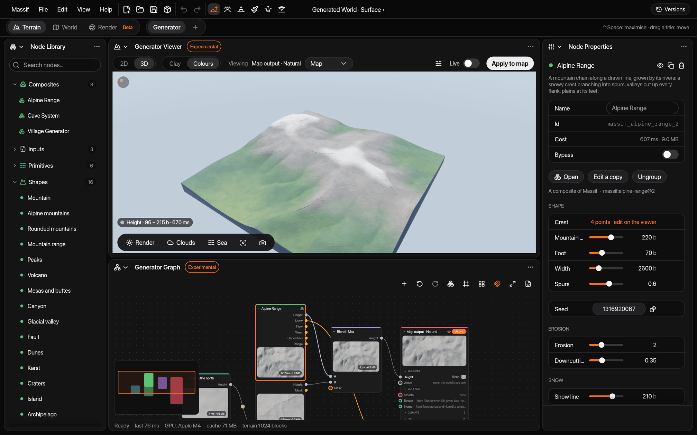
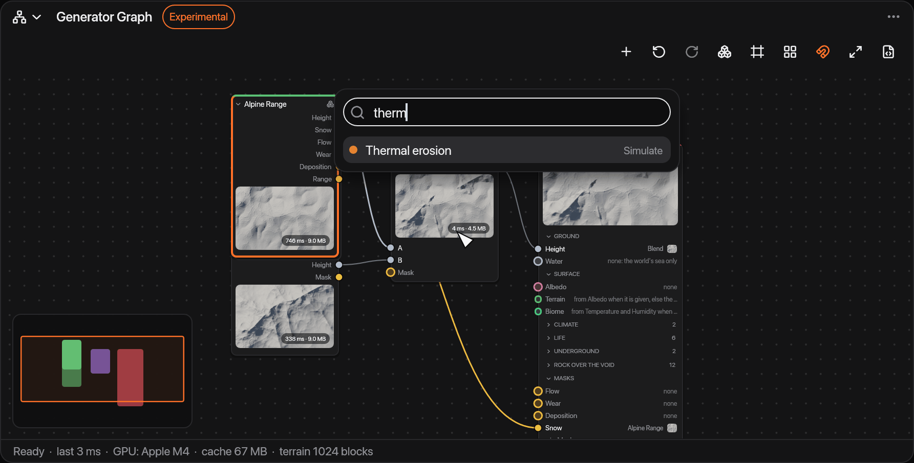
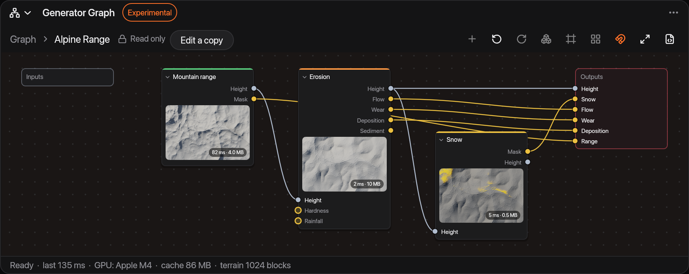
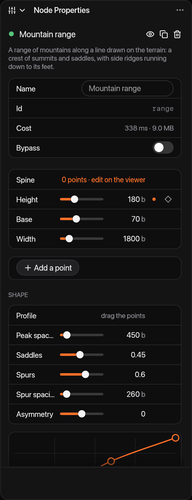
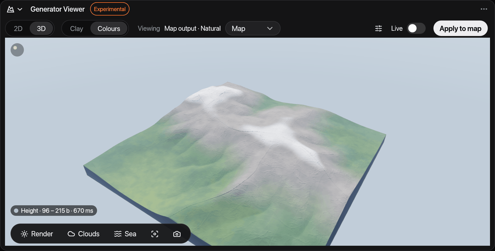
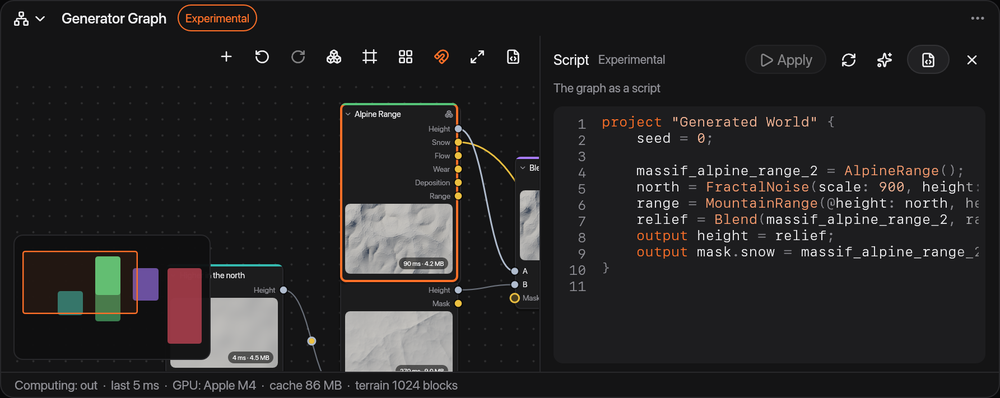

# Terrain graphs

[← Back to the README](../README.md)

The **Terrain** side of Massif makes landscapes from nodes, in the spirit of Gaea and World Machine: shapes, erosion, rivers, climate, caves and villages wired into a graph, seen lit in a viewer, then written into the map. Switch to it at the top left of the window.

Its **Generator** workspace holds the **Terrain Generator** of 1.2, four panels that work together: the **Node Library**, the **Generator Viewer**, the **Generator Graph** and **Node Properties**. The first pages below are about it. A graph can also be written as text, in [MassifScript](massifscript.md).

The Terrain Generator is Massif's only generator. A map made with the generator of earlier versions, the classic graph, opens with that graph converted into the Terrain Generator's, node by node (see [Graphs of earlier versions](#graphs-of-earlier-versions)).

Every node and every setting is listed in [terrain-nodes.md](terrain-nodes.md).

## The Terrain Generator

The Terrain side opens on the **Generator** workspace, its panels marked **Experimental** while the generator finds its way. The samples and templates of the home screen open there, with their graph and its preview, and the World side only when you go to it (Apply, or the side switch).

Follow the connections beneath the preview to see how each node contributes to the alpine terrain. [View full size](assets/workspaces/terrain-generator.webp).

The four panels are laid out as one, and like every panel of Massif each can be moved, swapped, put in tabs, floated in a window of its own or closed, and chosen again from any area's panel chooser, in its **Terrain** section:

- **Node Library**, on the left: the generator's nodes by category, to search and add. A node clicked lands in the middle of the graph's view; dragged, where it is dropped. Composites are listed under **Composites**.
- **Generator Viewer**, top middle: the selected node's terrain, or the Map Output's, lit, in 2D or 3D, with **Live** and **Apply to map** (see [The Generator Viewer](#the-generator-viewer)).
- **Generator Graph**, below it: the nodes and their wires, with the **Script** pane (MassifScript) and a status line at its foot: what is computing, how long the last picture took, the graphics card, the cache (see [The generator graph](#the-generator-graph)).
- **Node Properties**, on the right: the selected node's settings, or the graph's own when no node is selected (see [Node settings](#node-settings)).

They work together wherever they are: selecting a node in the graph shows its settings and its terrain, and undo over any of them undoes the graph's last change. The graph is saved with the world.

### What a graph makes

A graph ends in one **Map Output**, like Blender's
Material Output: one node with an input for each thing the map can take —
Height, Water, Albedo (the colour of the ground), Terrain, Biome,
Temperature and Humidity, Vegetation, Caves, four layers of rock (with their
colours) and any mask (`mask.snow`, `mask.flow`, `mask.<name>`). Each input is
optional and says what it stands for when left empty. Sockets have types, in
colours: heights, masks (0 to 1), colours, vectors (wind), terrains and
biomes; a height and a mask feed each other, a colour feeds a number by its
brightness, a number a colour as a grey.

### Nodes

Shapes a mountain map is made of (ranges along a drawn crest,
peaks placed by hand, alpine and rounded massifs, volcanoes, mesas, canyons,
glacial valleys, fault scarps, dunes, karst, craters, islands, archipelagos
along a chain, coastlines), adjustments (levels, curves, terraces, strata,
folds, warps, sharpening, transforms), simulations (thermal and stream
erosion, water flow), climate (temperature, wind, rainfall with rain shadows,
humidity, the game's biomes), masks of what the relief is (slope, height,
curvature, facing, sunlight, openness, snow, wetness, distance), colours
(gradients from nature, mixes) and terrains (layers by masks). Positions are
fractions of the terrain, distances and heights blocks. Every node and
setting is listed in [terrain-nodes.md](terrain-nodes.md).

### Light primitives, Transform and Combine

As in Gaea, a landscape can be built from a few light pieces rather than
one heavy node. **Mountain** makes one mountain in the middle of the
terrain from six settings: **Scale** (its width at the foot), **Height**,
**Style** (Basic, Eroded, Old, Alpine, Strata), **Bulk** (Low, a slender
peak, to High, a massif), **Reduce details** (leaves the finest relief to
erosion, and previews faster) and **Seed**. It costs about half what
Alpine mountains cost (10.5 against 23.4 ms for a tile of 256² at full
detail on one core). **Transform** then moves, turns, scales, stretches and
deforms a relief, at full detail, tile by tile (its first version worked at
the simulations' resolution and stays for graphs made with it). **Combine**
gathers any number of reliefs: connect **In 1**, and an empty **In 2**
appears, and so on; each input after the first has a **Mask** of its own,
and they combine in the order of their numbers by one mode (Blend, Add,
Subtract, Max, Min, Multiply, Average, Difference, Screen, Overlay, Power)
and **Strength**. In MassifScript the inputs are given in order,
`Mixer(a, b, c, mode: "max")`, a mask by its name in backquotes
(`` `mask.2`: m ``); in a graph's JSON they are `in.1`, `in.2`… and
`mask.2`, `mask.3`….

### Erosion

**Erosion** (in the Simulate family, a new version of Stream erosion) turns
lumps into ranges drained by real valleys. Water gathers into rivers that
cut their beds by stream power (the more water and the steeper, the
deeper), carry what they cut and lay it down where they slow, while the
slopes between them creep and slide back to the talus angle. It works
coarse to fine over the whole terrain, so that a river runs on from one
valley to the next, and Apply window by window gives the same as one
Apply: there are no seams. Its settings are Gaea's: **Duration** (how long
the land has eroded), **Downcutting** (deep narrow valleys and sharp
ridges, or broad valleys and rounded hills), **Erosion scale** (how wide
the smallest valleys are; wider works coarser and quicker), **Sediment
removal** (0 fills the valley floors and spreads fans, 1 carries it all
out), **Rock softness**, **Base level** (nothing is cut below it, nor
below the sea), with the **Talus angle**, **Steps** and **Seed** further
down. **Hardness** and **Rainfall** masks vary the rock and the rain; its
**Flow**, **Wear**, **Deposition** and **Sediment** masks colour rivers,
gullies and alluvium. It is about a hundred times quicker than Stream
erosion: 46, 148 and 660 ms for a simulation of 512², 1024² and 2048²
samples, against 3.0, 15.4 and 83 s. The same graph gives the same result
on any machine. Graphs made with Stream erosion keep it (`Erosion@1` in
MassifScript), and the **Alpine Range** composite now uses Erosion (its
version 2: Erosion and Downcutting exposed, a Deposition output).

### The relief bench

`tools/relief_bench.sh fetch` downloads five real landforms once
(Copernicus GLO-30 elevation tiles, 168 MB, outside the repository: the
Bernese Alps, Monte Perdido, the Grand Canyon, the Appalachian plateau and
Pico in the Azores); `tools/relief_bench.sh run` measures each against
Massif's nodes on a terrain as wide (16.4 km), their heights brought to the
same range: the slope distribution, the hypsometric curve, the drainage and
ridge densities and the curvature of valley floors, with a gap from 0 (the
same) to 1 (far) for each, and a board of hillshades side by side
(`relief-bench.md`, `relief-bench.png`). The measures live in
`massif_terrain::bench`, so that work on erosion and shapes is judged by
numbers.

### Underground

A **Cave layer** node is one of the map's cave layers
made by the graph (chambers, tunnels, noodles and ravines with their
densities, sizes and heights, the roof, the surface entrances, sealed
aquifers and the lava floor), and its mask says where its caves go; a
**Cave biome** node paints lush caves, dripstone caves or the deep dark
between two heights where a mask says. **Merge cave layers** takes the
stronger of two, or, with **Both**, stacks cave biomes at their own heights
in the same columns. The composite **Cave System** puts them together over a
relief: the game's caves, lush caves under wet ground, the deep dark far
under the mountains, dripstone caves between, with its densities, depths,
water and lava and biomes as settings; open it to change its rules. They go
to the Map Output's **Caves** and **Cave biomes**: Apply adds or updates the
graph's own cave layer (marked as the graph's, removed when its node is),
leaves the layers painted by hand where the graph puts no caves, and the
caves are carved, sealed and decorated on export as painted ones are.
**Volumes** are for what cave layers cannot do: a **Tube** along a drawn
line or a river's or road's splines, a **Sphere** (a hall, or one at each
point Scatter places), a **Box**, **Cave noise** (the game's noise caves as a
volume), a **Noise volume**, combined by **Combine volumes** (union,
subtract, intersect, with a smooth seam), roughened by **Shape volume** and
kept to a band of heights, a mask or under the ground by **Limit volume**.
The Map Output's **Volume carve** cuts its volume out of the ground, **Volume
add** fills its volume with rock: Apply writes them into the map's sculpted
blocks, where only the volume reaches.

### Examples

Five graphs to start from: an alpine chain with a glacial
valley, chalk cliffs over coves, desert mesas over dunes, a volcanic
archipelago, a canyon in a high plateau.

### Graphs of earlier versions

A map made with the classic graph, the generator of Massif before the
Terrain Generator, opens with that graph converted: each node becomes the
node (or the few nodes) doing the same, with its settings, links, place and
seed, and the Map Output takes what its outputs took. What the Terrain
Generator has no node of its own for (floating islands, overhangs, tectonic
plates, the classic Erosion, rivers, lakes, the sea, Auto colour) becomes a
node marked 1.2, which runs the old code, so it makes the same terrain.
Nodes of plain arithmetic (Constant, Levels, Clamp, Combine, Blend, Normalize
and the like) make the same heights too. The noises are the Terrain
Generator's own, so the nodes built on noise (Noise, Cells, Mountain,
Mountain range, Volcano, Craters, Dunes, Canyon, Mesas, Island, Warp,
Gradient colours and the like) keep their shape, size and settings but not
their exact patterns: a converted mountain range of 71 to 144 blocks rises
from 72 to 161 blocks, its mean height within two blocks.

A map that has a Terrain Generator graph of its own keeps it to drive the
map: the converted nodes are added below it, unwired, in a frame titled
**From the classic graph**, with their own Map Output, which is not the
active one. Link them to the graph, or make their Map Output the active one,
to use them. Once the map is opened, a notice says how many nodes were
converted and which ones are close rather than the same. Saved, the map
keeps only the Terrain Generator's graph; older files still open.

### For models and scripts

A graph is a readable JSON document (named
nodes, inputs naming what feeds them). [terrain-graph.schema.json](terrain-graph.schema.json)
is its JSON Schema and [terrain-nodes.md](terrain-nodes.md) its catalogue,
both written from the generator itself. From the command line:
`massif-cli terrain validate` names each mistake by its path and the name
probably meant; `terrain patch` applies edits a step at a time (add, set,
link, unlink, remove, rename) or a JSON Patch; `terrain render` draws a
graph; `terrain migrate` prints a world's graph, migrated; `terrain build`
builds a graph into a world.

## The generator graph

- **Add a node**: right-click the graph, press **Shift A** (or Tab outside a composite), or use
  the **+** at the graph's top right, and type a few letters of its name:
  the start of a word (`therm` finds Thermal erosion), or its letters in
  order (`mtnrange` finds Mountain range). Arrows choose, Enter adds. A
  node can also be clicked or dragged from the Library.
- **Select** a node by clicking it (Shift or ⌘ adds to the selection), or
  drag a box around nodes on the empty graph. Drag a node to move it with
  the rest of the selection; let go, it snaps to the grid (the magnet at
  the graph's top right places nodes freely instead).
- **View** a node in the viewer: press **V**, or double-click it (a
  composite opens instead). The eye on a node says it is the one viewed.
  With none viewed, the viewer shows the active Map Output.
- **Name** a node: its settings' **Name** gives it a name to show. Its id,
  by which wires and scripts name it, never changes.
- **Bypass** a node (**M**, as Blender's mute, or its menu): it is left out, and what it feeds
  takes its first input instead. It shows dimmed, struck through, its
  thumbnail that of what passes through.
- **Fold** a node to its title with the chevron at its left, or **H**.
- **Copy and paste** nodes (⌘C, ⌘V): they go through the clipboard as
  JSON, with the wires among them, their frames and the composites they are
  made of, so that they paste into another world too. **⌘D** duplicates
  beside them; **Shift D** duplicates and moves the copies with the pointer.
- **Remove and reconnect** (⌘X, as Blender's Ctrl X, or a node's menu):
  the selected nodes go, and what they fed is wired from what fed them, by
  their first wired input, when what it carries fits.
- **Arrange**: the grid button lays the selected nodes (or all) out in
  columns, from their sources to their output; a node's menu also aligns
  the selected nodes' left edges or tops, and spaces them evenly.
- **Zoom and move**: a mouse wheel or a pinch zooms around the pointer,
  from far enough out to see a big graph whole to close enough to read a
  node's every word; **⌘+** and **⌘−** zoom too, **⌘0** back to full size.
  Two fingers on a trackpad move the view, as dragging with the middle
  button does (or with Space held). **F**, the frame button, or a
  double-click on the empty ground shows the whole graph.
- **Minimap**: at the bottom left when part of the graph is out of view,
  the part in view outlined. Click in it to go there, drag the outline to
  move the view; the wheel over it still zooms the graph.
- **Undo** and **Redo** (⌘Z, ⌘⇧Z) take back the graph's changes while the
  pointer is over the area, inside composites too; a drag or a slider
  moved is one step.

Every change to what the graph makes goes through the graph's own editing
steps (add, set, link, rename, bypass, frame, group, expose…), the same a
script or a model uses: see [For models and scripts](#for-models-and-scripts).

Each node shows its result as a thumbnail, lit as the viewer lights it,
with the range of its values (in blocks for a height, from 0 to 1 for a
mask) when the graph is zoomed in.

### Composites

A composite is a node that holds a graph of its own, with inputs, outputs
and settings it exposes. Massif ships **Alpine Range** (a chain along a drawn crest, its rivers
cutting valleys up every flank, snow above a line), **Cave System** and
**Village Generator**; any nodes can be made into one of the world's own.

- **Make a composite**: select nodes and press **⌘G** (or the composite
  button). They go inside a new composite, one node of it in their place;
  the wires that crossed into them become its inputs, those that left them
  its outputs. **⌘⇧G** (or **Ungroup**) puts a composite's nodes back.
- **Open** a composite: double-click it, click the stack at its top right,
  or **Open** in its settings. The graph shows what it holds, a breadcrumb
  at the top (`Graph › Alpine Range`) leads back, as **Esc** does. Its inputs
  and outputs are two columns at the graph's edges: wire from the inputs'
  column, and into the outputs' column to say what each output gives.
- **Massif's composites** open read only. **Edit a copy** makes the world's
  own copy, under a new name, which the node then is; its settings are
  kept.
- **Expose a setting**: inside a composite of the world, the **⤴** beside a
  node's setting shows it on the composite, under a label, in a group,
  with its range, folded away as advanced if you like. Every node of the
  composite then shows it in its settings, as a node's own.
- With nothing selected inside, the settings show the composite itself:
  its name, its group in the library, its inputs and outputs (add or
  remove them) and its exposed settings.

Composites are listed in the library under **Composites** and found by the
search like any node. They are saved with the world.

### Frames

Frames gather nodes under a title, a colour and a note; frames sit in
frames. Select nodes and press **⌘J** (or the frame button) to frame them,
in the frame they all sit in. Drag a frame by its title to move it with
everything it holds; a node dropped inside a frame joins it, dragged out it
leaves it; a frame dropped in another sits in it. The chevron folds a frame
to its title bar, its wires ending on it. Click its title to show its
settings (title, colour, note, folded); double-click to rename it;
right-click it for its colour, or to remove it (the nodes stay).

### Sockets and wires

What a socket carries shows in its colour and shape:

| Socket | Carries | Colour |
|---|---|---|
| ● | a height, in blocks | slate grey |
| ● | a mask, from 0 to 1 | amber |
| ● | a colour | pink |
| ● | a vector (wind, the way water flows) | indigo |
| ■ | a terrain (the block material), one per column | green |
| ■ | a biome of the game, one per column | teal |
| ■ | a painted layer (its number and strength) | olive |
| ▶ | points (where things stand) | cyan |
| ▶ | lines (roads, rivers, walls) | orange |
| ▶ | footprints (the ground things take) | tan |
| ▶ | instances (what stands there) | sky blue |
| ⬢ | a volume (caves, arches, overhangs) | violet |
| ◆ | a setting driven by a field (see [Settings](#node-settings)) | amber |

Circles carry values that vary smoothly, squares categories, triangles
geometry made whole, hexagons volumes, diamonds settings that vary over the
map. A filled socket is connected; an empty
ring is an input left empty, which takes the default its node says.

Drag from an output to an input to connect them; let go on an empty part
of the graph to add a node that takes what the wire carries, connected.
Drag from a connected input to take its wire elsewhere. A wire between
two different types (a height into a colour, a colour into a mask) is
converted on its way, and a dot on the wire says so; categories are never
made from numbers on a wire: a node says how. An input that cannot take
what the wire carries turns red under it, and says why and which node to
put between them (points into a mask: **Points to mask**). Right-click (or Alt-click) a
wire to cut it; double-click it to add a reroute point, which drags, and
which a right-click removes.

## The Map Output

A graph ends in one **Map Output**, as a Blender material ends in its
Material Output: one node with an input for everything the map can take,
in groups that fold (Ground and Surface open, and any group with an input
connected):

While a wire is drawn near it, the Map Output's folded groups that hold an
input taking what the wire carries open by themselves (a layer opens
Underground, for the caves), and fold again if the wire goes elsewhere; the
inputs that take it glow, on every node. Folded, a group says how many
inputs it holds, and how many are connected. A graph with no Map Output
says so at the top of the canvas, with a button that adds one, its Height
fed by the rightmost node making heights; Apply says so too.

- **Ground**: Height, Water.
- **Surface**: Albedo (the ground's colour), Terrain, Biome.
- **Climate**: Temperature, Humidity. **Life**: Vegetation. **Underground**:
  Caves.
- **Rock over the void**: the top and underside of layers of rock over the
  ground (floating islands, arches).
- **Masks**: Flow, Wear, Deposition, Snow, and masks of one's own: **+ Mask**
  adds one (double-click its name on the node to rename it), written to the
  map under its name.

Every input is optional. A connected one shows a small picture of what
arrives and where from; an empty one shows in grey what stands for it
("the map's ground as it is", "none"). A graph can hold several Map
Outputs to compare variants: the one marked **Active** is the one the map
takes; click **Inactive** on another (or use its menu) to make it the
active one.

## Node settings

The selected node's settings are made from the node's own description, in
groups: its main settings, **Shape**, **Detail**, and **Advanced** on demand.
Every setting has its editor: a slider with its unit for a number (the
slider covers the usual range; a value beyond it can be typed), a switch, a
choice, a colour, a seed with a die for another one, a file, points and
lines (placed on the viewer, or typed in a table), a curve from 0 to 1
(drag its points, double-click to add one, right-click to remove one), and
a gradient (drag its stops, click one to colour it, double-click the bar to
add one). A dot beside a setting changed from its default puts it back.
The foot of the panel says what the setting under the pointer does.

**◇ — settings driven by a field.** A number marked ◇ can vary over the
map: click the ◇ and the node gets a diamond socket for it; connect a mask
there and the setting takes, at each place, the mask's value there
(a mountain higher in the north, an erosion stronger on soft rock).

With no node selected, the panel shows the whole graph's settings: the
terrain's size, its seed, the sea level and the resolution simulations run
at in the previews.

## The Generator Viewer

The viewer shows the node viewed, or the active Map Output, lit as a
render: a sun from the north-west, soft shadows, light from the sky in
the hollows. **2D** shows it from above; **3D** from a camera turning
around it. **Clay** shows the shape alone, in neutral grey, as Gaea does;
**Colours** shows the ground's colours (the Albedo reaching it, or tints
by height when there is none). A mask shows in amber over the relief it
comes from; a colour, a terrain or a biome as its colours on that relief.
A picture comes coarse first, then sharp.

- 2D: drag to move, scroll to zoom around the pointer, double-click to see
  the whole terrain again.
- 3D: drag to turn around the terrain, scroll to come closer; turning
  keeps the camera's distance, only the wheel changes it.
- **Shift + drag** turns the sun, in both.
- **View** options, the sliders beside 2D/3D and Clay/Colours: they
  change only what the viewer shows, never the map. How much the relief is
  exaggerated, contour lines, the mask's opacity, the sun's height, the 3D
  view's **Background** (plain **Dark**, as in Gaea, by default, or the
  **Sky**), the **Resolution** (Auto: as many samples as the picture
  needs, at most 1024 a side; or 1K, 2K, 4K or 8K, the last two heavy in
  memory and slow, as the options say).
- Whether the nodes' thumbnails are in clay or in colours is the graph's
  setting **Node thumbnails**, in Node Properties with no node selected.
- The selected node's points or line (a range's spine, peaks) show over the
  2D picture: drag them, double-click to add one, right-click to remove
  one.
- What is done to the map stands apart, on the right after a line:
  **Live** shows the graph's result on the World map as it is edited,
  without writing it; **Apply to map** writes it, in one step that can be
  undone (see [Apply](#live-and-apply)); the arrow beside it holds the
  other ways to write the terrain.

The viewer opens in **3D**, under the sky. A map made from a template, or a sample of the home screen, is seen as its template is best seen: its sun, clouds, haze and sea. With the Map Output viewed, the 3D view shows the map's whole result: its relief and colours, the water of its rivers and lakes (the Water input), and its layers of rock over the ground (floating islands, overhangs), as the map will have them. The arrow beside **Apply to map** holds **Keep the map's ground**, which writes what the graph digs and raises into levels of their own, the map's ground staying as it was (they can be hidden or deleted in the Levels panel), and **Height map: Save…**, which saves the terrain at a block a sample as a 16-bit PNG height map, black the world's lowest Y and white its highest, without writing it into the map.

In **3D**, the viewer draws the generator's output under a sky with soft light, clouds, the sea at the world's sea level and the sides of the terrain, with a camera you turn, move and zoom freely. Its bar at the foot opens the render settings (sun, clouds, haze, exposure), turns the clouds and the sea on and off, frames the relief and saves the view as an image. The **Dark** background shows a plain dark backdrop in place of the sky.

## Live and Apply

With Live on, the World side's map shows the graph as it is
edited, without writing it: the area in view first, sharp within a few
milliseconds on the graphics card, the rest of the map behind; simulations
run quick first and exact once the graph rests. **Apply** writes it to the
map in one undoable step, as Convert does.

**Apply to map** writes everything the active Map Output carries into the
map, as one step that ⌘Z takes back whole:

- the ground (heights, water, terrains, colours as blocks, layers of rock,
  biomes of the climate), made window after window of 1024 blocks, so that
  a large map is written without ever holding all of it;
- what goes underground: the cave layers of its Cave Layer nodes (marked as
  the graph's, updated on the next Apply, never mixed with those painted by
  hand), the cave biomes, and the volumes carved out of the ground or added
  to it;
- its villages: the Map Output's structures and roads, laid on the ground
  as written. The villages an earlier Apply laid are replaced; structures
  placed by hand stay.

A dialog shows how far it is (the terrain window by window, then the
caves, then the villages); **Cancel** stops it and leaves the map as it
was. A map of 2048 blocks a side with a mountain and its erosion is
written in about a second.

Thumbnails and the viewer show every kind of output: points, lines,
footprints and instances drawn over the relief they stand on, and a volume
as its cut a little under the sea's level, laid over the relief.

> 📷 **Screenshot:** the World side's map with **Live** on, the graph's result drawn over the map before Apply, and the Apply progress dialog.

## MassifScript

A graph can be written as text, and text made into a graph: the **script** button at the top right of the Generator Graph (a page with `<>`) shows the **Script** pane. **Apply** builds the graph from the script (one step to undo), **From graph** writes the graph open as a script, and **Copy for AI** copies a guide to paste into any AI chat (ChatGPT, Claude, Mistral…): the language, every node, examples and the graph open now. Paste the script it answers into the pane, and Apply. See [MassifScript](massifscript.md) and [its reference](massifscript-reference.md). An MCP server, so that an AI assistant could work on the graph in Massif directly, is planned, not shipped.

## Generator keys

The keys are Blender's node editor's: Ctrl works as ⌘ on a Mac. They act
while the pointer is over the graph and no text field is typed in (the
Script pane's included).

| Key | Over the graph |
|---|---|
| Shift A, right-click | add a node at the pointer |
| Tab | open the composite selected, or leave the one open (at the top, with none selected: add a node) |
| double-click | open a composite, view another node |
| Esc | deselect; nothing selected, leave the composite open |
| V | view the node |
| ⌘A | select every node |
| Alt A, ⌘⇧A, Esc | deselect |
| ⌘I | invert the selection |
| B | box select: drag a box from the next press, over nodes too |
| L, Shift L | add the nodes feeding the selection, or those it feeds |
| G | move the selection with the pointer: a click puts it down, Esc or a right-click puts it back |
| Shift D | duplicate and move the copies with the pointer |
| ⌘D | duplicate beside them |
| ⌘C, ⌘V | copy, paste at the pointer |
| X, Delete, Backspace | remove the selected nodes (a frame selected: the frame, its nodes staying) |
| ⌘X | remove and reconnect |
| M | bypass the selected nodes, or stop (Blender's mute) |
| H | fold or unfold the selected nodes |
| ⌘G | make a composite of the selected nodes |
| ⌘⇧G, ⌘⌥G | ungroup the composite |
| ⌘J | frame the selected nodes |
| F, Home, double-click the ground | show the whole graph |
| . (numpad .) | show the selected nodes |
| wheel, pinch, ⌘+ ⌘− ⌘0 | zoom (⌘0: full size) |
| ⌘Z, ⌘⇧Z | undo, redo |
